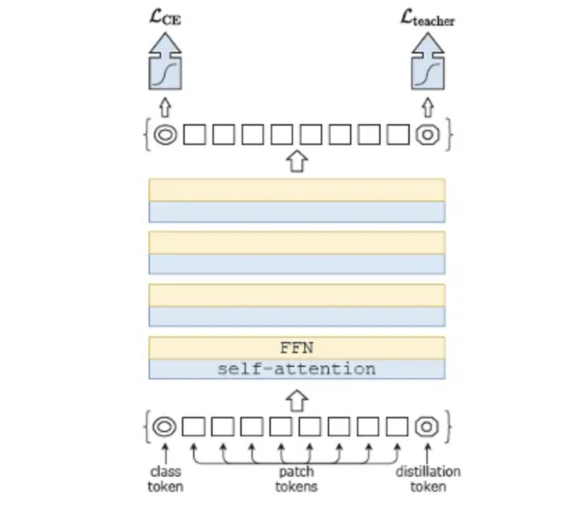
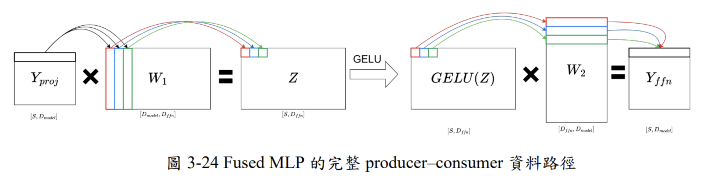

<!-- _class: cover -->
<!-- _paginate: false -->

# 以層融合為導向之具雙重與三重駐留資料流之可重組多區域脈動陣列 Transformer 硬體加速器

`中山大學` `碩士論文`

許維棠

2026/9/7

報告人：莊翔鈞

<!--
今天報告學長剛口試完的碩論,主題是Transformer硬體加速器,
鎖定DeiT-Small這個視覺模型,核心貢獻是資料流的混合設計。
-->

---

## 為什麼 Transformer 需要蒸餾

|  | CNN | Transformer |
|---|---|---|
| 先驗假設 | 局部性、平移不變性 | 無 |
| 感受野 | 逐層擴大 | 第一層就全域 |
| 訓練資料 | 少 | 多(除非蒸餾) |

CNN 天生自帶「歸納偏好」,Transformer 什麼都要自己學

<!--
CNN靠卷積核的權重共享跟局部視窗,天生就有「平移不變性」這種先驗知識,
少量資料就能學得不錯。Transformer沒有,
理論上什麼規律都學得到,只是要花更久、更多資料。
-->

---

<!-- _class: fig -->

## 研究對象:DeiT-Small

ViT 的問題:需要巨量訓練資料(如JFT-300M)

DeiT 直接找CNN當teacher,用**知識蒸餾**加速學習



<!--
Facebook 團隊想到的是,用知識蒸餾改vit的訓練方式。
用一個額外的distillation token,搭配teacher模型(通常是CNN)做知識蒸餾,
把CNN的那些先驗知識,透過蒸餾捷徑灌給Transformer,
讓模型可以用少很多的訓練資料達到接近的效果。

這個distillation token在推論階段一樣要參與運算,
所以序列長度是198,不是196或197——這個數字後面第三章會反覆用到。
-->

---

## 量化技術演進

- I-BERT(2021)
- PTQ4ViT(2021)
- FQ-ViT(2022)

（此研究最終採用 **INT8 全整數**）

<!--
I-BERT先證明BERT可以用純整數推論,但發現像是Softmax、GELU這些
非線性函數天生跟整數運算不合。

PTQ4ViT進一步發現量化容易破壞attention weight的相對排序,
提出ranking-aware quantization,在設計量化的時候就保證相對順序。

FQ-ViT則是針對非線性函數用分段線性/多項式近似,並重新設計
量化尺度跟運算順序,減少跨模組反量化的需求,還引入layer-aware
量化,不同模組用不同的位元配置——擺脫PTQ4ViT仍需保留部分
高精度的混合精度做法,朝向完全量化前進。
-->

---

## FLAT 的啟示:瓶頸不是算力,是搬資料

```text
L = QK^T → Softmax → A = PV
```

每一步算完都要進出記憶體 → 中間結果反覆存取才是真兇

<!--
2023年的FLAT發現:Attention慢,不是因為乘法器不夠多,而是L、Softmax、A這三步之間
的中間結果,一直被搬進搬出記憶體。這篇論文的Layer Fusion概念,就是受FLAT啟發。
-->

---

## 為什麼 Batch Size 對 Attention 沒用

```text
FC層(Q/K/V生成、Projection、FFN):
  Weight對整個batch共用 → batch越大,weight載入成本被攤得越薄
  運算量隨batch線性增加,搬移量的固定項(weight)不變
  → 運算強度隨batch上升

QK^T、PV:
  Q,K,V每筆輸入各自獨立算出來,沒有共用的權重可以攤
  batch增加時,運算量跟搬移量同步等比放大
  → 運算強度完全不變
```

**判斷準則:這個運算有沒有「全batch共用的固定權重」**

<!--
FC層的權重矩陣,不管batch多大,大家都乘上同一份——所以batch越大,
這份固定成本被攤得越薄,運算強度自然上升。

QK^T、PV則完全不一樣:Q、K、V是每筆輸入資料各自算出來的,
不是像weight那樣共用的東西。
增加batch,Q、K、V的資料量也跟著等比例增加。

這也解釋了為什麼邊緣裝置的處境比資料中心更慘:
資料中心至少FC層還能靠batch解套,只有Attention是死穴;
邊緣裝置因為batch很小,FC層跟Attention兩邊
都要靠資料流設計去處理。
-->

---

## FlashAttention:具體怎麼「不落地」

Softmax 需要看過整列才能算分母 → 傳統做法要先存下完整 L

**Online Softmax:分塊處理,遇到更大值時用修正項回頭校正**

```text
處理block 1: 算出暫時最大值、暫時總和
處理block 2: 發現更大值 → 用修正倍率校正之前的結果 → 累加新結果
...
跑完所有block:結果與「一次算完」數學上完全等價
```

<!--
FlashAttention提出的online softmax:不需要等看完整列,
就能開始累加輸出。

作法是,每處理一個新的block,就檢查有沒有出現比目前紀錄的
最大值更大的數字。如果有,就用一個修正倍率(exp(舊最大值-新最大值)),
回頭校正之前已經累積的部分結果,再繼續往下加。
-->

---

## dataflow 分析

---

## 分析的共同語言

```text
GEMM = 兩個矩陣相乘的通稱

Tile = 把大矩陣切成小塊處理的那一小塊

Reduction維度 = 矩陣乘法裡「要被加總、消失掉」的那個維度
```

```text
Y[i,j] = X[i,0]W[0,j] + X[i,1]W[1,j] + ... + X[i,D-1]W[D-1,j]
                                                   ↑
                                        這個D,就是reduction維度
```

---

## DeiT-Small 參數

| 符號 | 數值 | 由來 |
|---|---|---|
| S | 198 | 196 patch + class token + distillation token |
| D_model | 384 | DeiT-Small規格 |
| H | 6 | head數量 |
| D_h | 64 | D_model÷H,Transformer家族的經驗慣例 |
| D_ffn | 1536 | D_model×4 |

---

## 三種 dataflow

| | 固定住 | Reduction切不切 | 取捨 |
|---|---|---|---|
| **OS** | 輸出 | 不切,一次做完 | 輸出access少,但需要較大容量 |
| **WS** | 權重 | 切 | 權重容量小,但partial sum反覆進出 |
| **IS** | 輸入 | 切 | 輸入容量小,但partial sum反覆進出 |

<!--
OS規定一次性把整個reduction做完才寫出輸出,
好處是輸出只需要寫一次,代價是需要較大的SRAM容量去放得下
完整的reduction維度。

WS、IS則是反過來,選擇切開reduction維度,讓權重或輸入固定
在PE裡、被重複利用,但partial sum會因為reduction被切分,
需要反覆進出SRAM去更新。
-->

---

| 運算 | Reduction維度 | 誰是主力候選 |
|---|---|---|
| FFN1 | 384(小) | OS + WS |
| FFN2 | 1536(大) | IS 主導 |
| Projection | 384 | OS + IS 互補 |

**Reduction維度大小,決定誰划算**

<!--
這是整個資料流分析的Pareto篩選結果。FFN1的reduction較小,
OS依然有競爭力;FFN2的reduction較大,OS的容量代價變高,
IS反而佔優;Projection則是兩者形狀比較對稱,OS跟IS互補。

這張表直接導出一個結論:如果把整個Transformer block,
從頭到尾固定用同一種資料流(不管選OS、WS還是IS),
一定會在某些stage上不划算——這正是Hybrid Dataflow
存在的理由。
-->

---

<!-- _class: fig -->

## Fused MLP:FFN1-OS + FFN2-IS



**中間那個1536維的龐大特徵,完全不進SRAM/DRAM**

不是「各自最佳解的拼接」,是為了銜接而設計的搭配

<!--
既然FFN1有好兩個候選,而FFN2是IS主導,學長提出的想法是:

FFN1用OS,一次把輸出算完才吐出來,這個特性剛好最適合
直接遞給下一棒使用。

FFN2用IS,把FFN1給的那一小塊資料直接固定在輸入端,
不需要另外找地方存放、之後又要讀回來。

不是先分別找兩個stage的局部最佳解、再湊在一起,
而是以block為單位去找更適合的dataflow組合。
-->

---

## Attention 比 FFN 更棘手

**比一般GEMM複雜的三個因素:**

```text
head-level repetition:   要對6個head各自重複整套分析
S×S中間矩陣:            L(198×198)要不要materialize是個問題
不同reduction維度:       Generate Q/K/V=384, QK^T=64, PV=198
```

**Pareto分析結果:OS、WS、IS三者都留了候選**

→ 傳統資料流分析在這裡碰壁,只能換思路,引入FlashAttention

<!--
FFN1、FFN2好歹還能從OS/WS/IS分出勝負,Attention不一樣——
論文說它比一般GEMM多了三個複雜因素:head要重複、有S×S的
巨大中間矩陣、後續步驟reduction維度不一致。

Pareto分析結果:OS、WS、IS三者都留了候選,沒人全面勝出。
論文沒有明確拆解這是哪個因素造成的,只呈現了這個結果。

結論很清楚:傳統框架在這裡分不出勝負,只能換路,
引入FlashAttention解套。
-->

---

## FlashAttention Hybrid:資料流怎麼設計

```text
Q算好,留著(外層,重複跟每個K/V block配對)

for each K/V block (內層,共6塊,用完即丟):
    生成 K_block, V_block
    L_block = Q × K_block^T
    online softmax:比較最大值,用修正倍率校正之前的輸出
    O += softmax結果 × V_block
```

**K、V、L、P 全部不進SRAM/DRAM,只有Q需要留著**

<!--
這是FlashAttention原始演算法的雙層迴圈結構:Q是外層,
跟每一個K/V block各配對一次;K、V是內層,切成小塊依序處理,
每個block算完立即被消費掉就丟掉了。

因為K、V的生命用完即丟,硬體上完全不需要
把它們寫進SRAM,唯獨Q需要留在SRAM,因為它要被重複使用6次
(對應6個K/V block)。
-->

---

## 理論模型怎麼變成 EAP 數字

```text
理論公式(access量、容量)
  → Ramulator2 + DRAMPower:模擬DRAM,算出真實latency與energy
  → CACTI:估算SRAM macro的面積、能耗、延遲
  → 整合成 EAP(Energy × Area ÷ Performance)
```

**公平比較的前提:所有dataflow用同一套工具、同一套INT8格式**

<!--
理論公式算出的access量、容量,還要轉成真正的能耗、面積數字
才能拿來比較——這一步就是把理論接上Ramulator2、CACTI這些
工具跑出PPA。

關鍵是公平比較:所有dataflow(OS/WS/IS/Hybrid)用完全相同的
工具設定、INT8格式、DDR4系統去跑,確保差異來自資料流本身,
不是評估條件不一致。
-->

---

## Block-Level 整合與最終排名

```text
FlashAttention_Hybrid → Projection_OS → LayerNorm → FFN1_OS → FFN2_IS
```

**用EAP綜合排名,Hybrid全面勝出**

| | Attention | Projection | FusedMLP | Block整體 |
|---|---|---|---|---|
| Hybrid | 第1 | 第1 | 第1 | **第1** |

<!--
EAP指標把Energy、Area、Performance濃縮成單一分數,用意是
避免只看Energy×Area,會忽略高平行度配置帶來的performance。

Hybrid在Attention、Projection、FusedMLP三個獨立分析,以及
合起來的Block-level比較,全部都是第一名。
-->

---

## 硬體實作

---

## 整體架構:為什麼PE array要拆兩塊

```text
一般FC運算(Projection/FFN): 兩塊合併成66×64,一起做同一件事

Attention: 拆成High(33×64)/Low(33×64)兩塊
  High PE Array生成K → 算QK^T
  Low PE Array生成V  → 算PV
```

**只有Attention需要「同時生成兩種不同東西」,FC運算不需要**

V 的啟動時間刻意延後,讓 P 算出來的瞬間剛好對上 V 準備好

<!--
PE array拆成兩塊(每塊33×64)是這章最關鍵的架構決策,直接
呼應FlashAttention Hybrid的需求:K跟V需要同時被生成,如果
只有一整塊陣列,勢必要先做完K才能做V,兩塊分開可以讓兩者
平行進行,不用互相等待。

排程上還有個小技巧:Value Generation刻意比Key Generation晚
啟動,讓Online Softmax算出的機率值P,跟Value tiles準備好的
時間點對齊,PV可以立即開始,不讓Low PE Array閒置。
-->

---

## 非線性函數:為什麼都要用查表法近似

**選擇INT8全整數路線 → GELU、Softmax、LayerNorm都不能直接算**

```text
GELU:   x × Φ(x)  ← Φ(x)是高斯CDF,用LUT近似,飽和區直接硬編碼
Softmax: 需要exp跟除法 → Online Softmax硬體化(Unnorm Engine)
LayerNorm: 需要平方根倒數 → 查表法 + 位移運算
```

**這些近似,都是「選INT8」這個決策必須付出的工程代價**

<!--
回顧第二章的量化脈絡(I-BERT→PTQ4ViT→FQ-ViT):非線性函數
天生跟整數運算不合,選擇INT8全整數路線,就必須自己設計
整數友善的近似方法,不能像混合精度那樣偷懶留給浮點數處理。

GELU用查表法逼近Φ(x),並利用它的飽和特性(輸入夠大或夠小時
已經趨近1或0),縮小LUT需要涵蓋的範圍,省下硬體面積。

Softmax的硬體版本就是Unnorm Engine,對應第二、三章反覆提到
的Online Softmax——分塊處理,遇到更大值時用修正倍率回頭
校正,不需要materialize完整的L、P矩陣。

LayerNorm的平方根倒數電路特別昂貴,論文用兩階段設計因應:
統計量累積階段維持高平行度(66 lanes),但標準差倒數運算
縮小到11 lanes——因為這段運算前面接的矩陣運算,反正要等
一段時間才會生出下一批資料,縮小平行度不會拖慢整體速度,
卻能省下大量硬體面積。
-->

---

## 規格與面積分布

| | |
|---|---|
| 製程 | 16nm FinFET |
| PE數量 | 4224顆 |
| 平均效能 | 7.825 TOPS |
| 面積 | 1.2 mm² |
| 功耗 | 1047 mW |

**面積分布:PE array(SA)佔 71.2%**

---

## 跟相關研究比較

| | vs 阮彥喆 (2024) | vs ViTA Huge |
|---|---|---|
| 效能 | **7.825 vs 1.982 TOPS(近4倍)** | 7.825 vs 16.384 TOPS(輸) |
| 面積 | **1.2 vs 5.25 mm²** | 只有ViTA Huge的15.6% |
| 關鍵原因 | [24]用單一WS,PE閒置多 | ViTA Huge效能更高,但面積功耗代價也高 |

<!--
跟阮學長比較最有說服力——[24]只用單一Weight
Stationary資料流,效能只有本研究的1/4,面積卻要5.25mm²,
論文自己解釋這是因為單一資料流會讓部分運算階段PE大量閒置。

面對效能更強的ViTA Huge,論文誠實承認自己效能較低,但在
面積跟功耗上有明顯優勢。
-->

---

## 對 LLM ASIC 的啟發

---

- Dataflow tradeoff框架:reduction維度大小 → 判斷OS/WS/IS
- Layer Fusion精神:減少中間結果落地,不改變運算量
- FC vs Activation-Activation的判斷準則:有沒有全batch共用的權重
- FFN的形狀邏輯通用(先放大4倍、非線性、再縮小)

<!--
這套判斷框架是通用的硬體加速器設計方法論,不限於ViT。
FFN在任何Transformer(DeiT、GPT、Llama)都長一樣,Fused MLP
的設計邏輯(OS-producer銜接IS-consumer)可以直接套用在
LLM的prefill階段。
-->

---

| | DeiT | LLM Inference |
|---|---|---|
| 序列長度 | 固定198 | Prefill平行,Decode每次+1 |
| KV | 算一次,不變 | 持續append |
| Attention規模 | O(S²) | O(S²) |
| Batch | 可以打包成66/33處理 | Decode階段batch=1,天生memory-bound |

**Decode階段是全新問題:GEMM退化成GEMV,weight reuse紅利直接消失**

<!--
DeiT的序列長度固定198,Attention的O(S²)項還沒機會膨脹,
FFN反而佔了約6成的MAC運算量。但LLM的context動輒幾千上萬,
S²項會遠遠超過FFN的線性項。

更關鍵的是decode階段:KV cache只會append、不會被修改,但
每次只生成一個token,矩陣乘法退化成矩陣乘向量(GEMV)。
FC層原本靠batch attention能吃到的weight reuse紅利,在
batch=1的decode階段完全消失。

另外,decode階段有causal mask,QK^T理論上有一半是注定被
遮罩掉的計算,如果硬體能聰明跳過,是DeiT完全不會遇到的
額外優化空間。
-->

---

<!-- _class: cover -->
<!-- _paginate: false -->

# Thanks!
