<!-- _class: cover -->
<!-- _paginate: false -->

# Efficient Processing of Deep Neural Networks: A Tutorial and Survey

Sze, Chen, Yang, Emer (MIT), 2017 — report by 莊翔鈞

<!--
今天報告這篇2017年的survey,是DNN硬體加速這個領域的經典教程,
作者同時也是Eyeriss這顆加速器晶片的作者。
-->

---

## 這篇論文想解決什麼

DNN準確率好,代價是高計算複雜度(大量MAC運算+大量參數)

<!--
DNN準確率好,但代價是高計算複雜度。很多應用場景想把inference
搬到edge裝置，但edge裝置能耗、算力、記憶體都很有限,這個落差
就是efficient processing要解決的核心問題。
-->

---

## 背景:CONV vs FC

**CONV**:小filter滑過ifmap,同一組weight被重複套用 → **weight sharing**

**FC**:每個output都要專屬一整組weight,沒有共用

→ CONV參數量遠少於FC,但運算量(MAC數)反而更大

<!--
CONV因為weight sharing,只需要存一份filter,不管ifmap多大;
FC因為每個output都要專屬權重,參數量=input數×output數,通常
遠大於CONV。但CONV的MAC運算量反而比FC大,因為同一份filter
會被拿去在整個ifmap上重複算很多次。
-->

---

## 背景:兩種平行運算典範

| | Temporal (CPU/GPU) | Spatial (ASIC/FPGA) |
|---|---|---|
| 平行手法 | SIMD/SIMT | Dataflow processing |
| ALU間 | 只能經記憶體溝通 | 可直接互傳資料 |
| 本地記憶體 | 無 | 有(PE自己的RF) |

<!--
Temporal(時間性)指同一時刻讓很多ALU做"同一件事",套用在
不同數據上——這是SIMD/SIMT運作的方式。Spatial architecture
用的是dataflow processing,不同PE在同一時刻可以做不同的事,
而且PE之間還能直接互傳資料。關鍵是因為PE有自己的RF,才可能
讓某種數據"stationary"焊在PE裡不搬走,所以後面介紹的dataflow
才有發揮空間。
-->

---

<!-- _class: fig -->

## 核心動機:一次MAC要多少次存取

3次讀(weight, activation, partial sum) + 1次寫

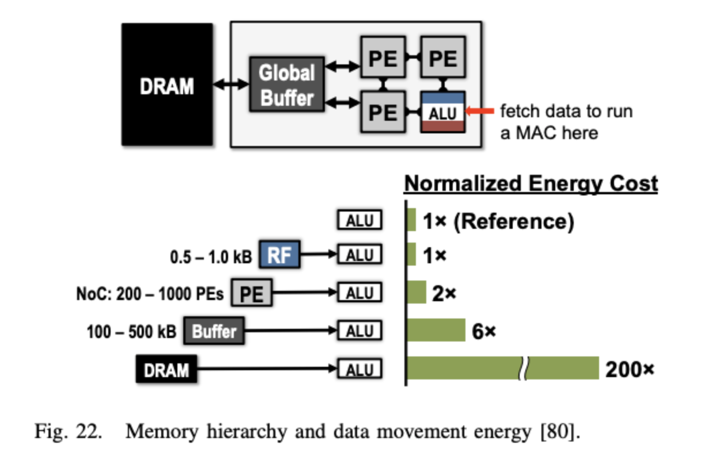

<!--
一次MAC運算要付出3次讀+1次寫。而DRAM存取的
能耗比RF貴200倍。所以硬體設計的重點不是塞更多乘法器,而是
想辦法讓資料重複使用發生在便宜的RF層級,而不是每次都跑去DRAM。
-->

---

<!-- _class: fig -->

## Data Reuse:Convolutional

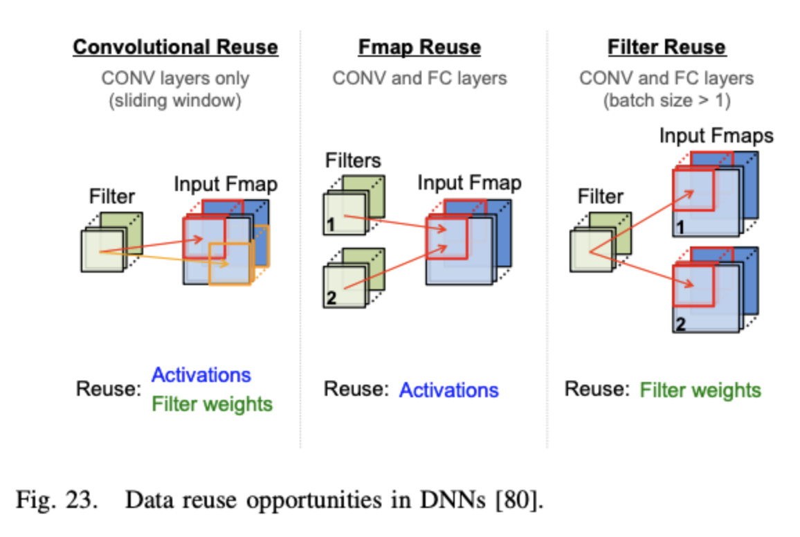

<!--
Convolutional reuse來自滑動窗口重疊,同一份input跟weight
會在相鄰窗口位置被重複用到。
-->

---

<!-- _class: fig -->

## Data Reuse:Feature Map

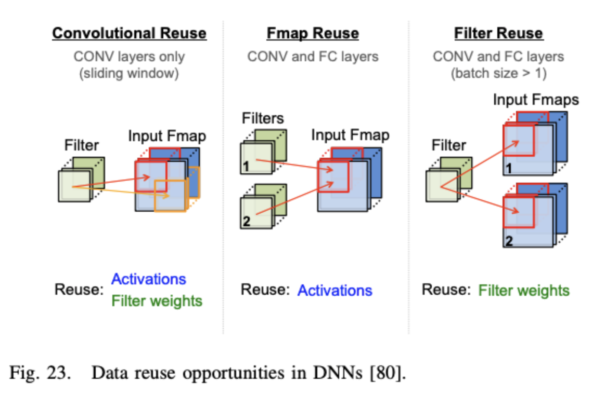

<!--
Feature map reuse是同一個ifmap
被拿去跟M個不同filter各自做乘加。
-->

---

<!-- _class: fig -->

## Data Reuse:Filter

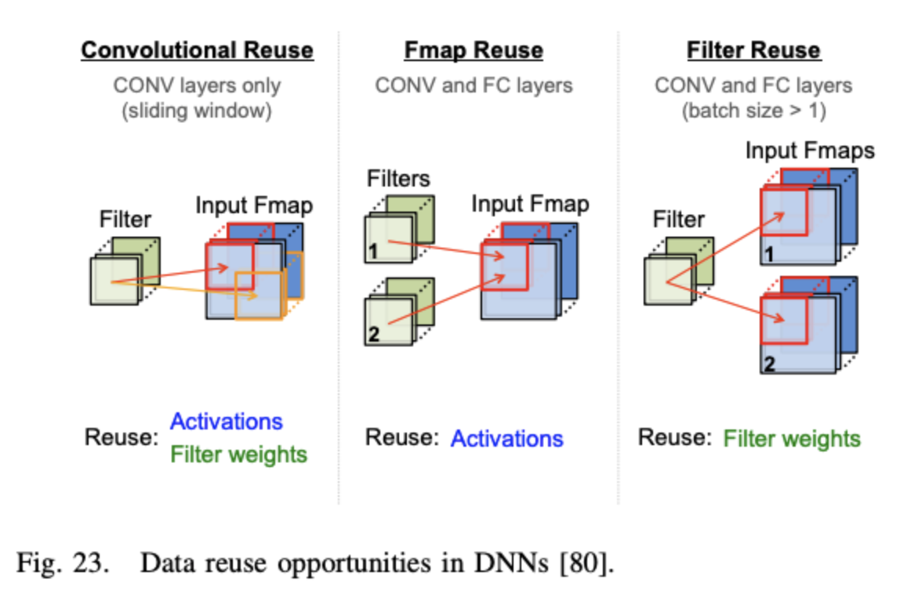

<!--
Filter reuse是同一組filter
被拿去跟不同筆batch的input做乘加。這三種reuse是後面四種
dataflow設計要去搶的資源——不同dataflow選擇優先兌現哪一種。
-->

---

<!-- _class: fig -->

## Dataflow:Weight Stationary

固定住:**Weight**　牽動:Convolutional+Filter reuse

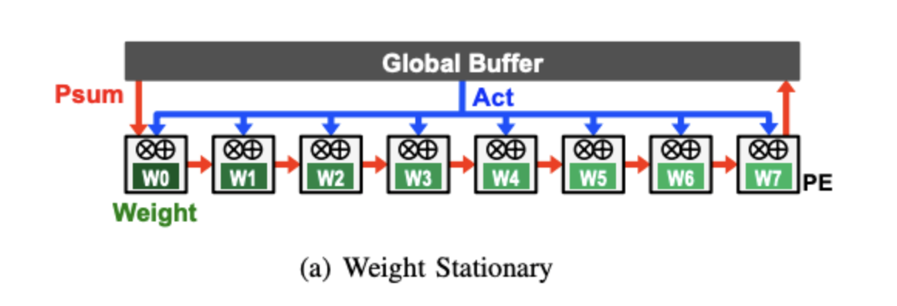

<!--
WS讓weight盡量待在RF裡參與越多次MAC越好,同時最大化
convolutional reuse跟filter reuse。Input activation是
broadcast給所有PE;partial sum則是跨PE累加傳遞。這樣做的代價是:
input靠廣播還算單純,但partial sum要跨PE正確地累加,需要
額外的延遲暫存元件確保時序正確。
-->

---

<!-- _class: fig -->

## Dataflow:Output Stationary

固定住:**Partial sum**　牽動:獨立於三種reuse之外

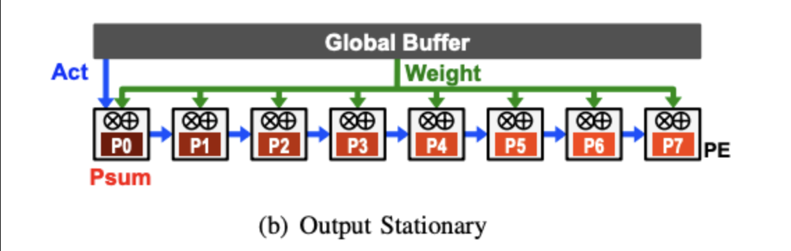

<!--
OS讓partial sum固定在RF裡從頭累加到底,不用讀寫外部記憶體。
Weight是broadcast給所有PE;input activation則是stream
流過PE array。代價是weight/activation都沒有被固定
利用,要一直重新從buffer搬進來。
-->

---

<!-- _class: fig -->

## Dataflow:No Local Reuse

固定住:**都不固定**　牽動:都沒優化

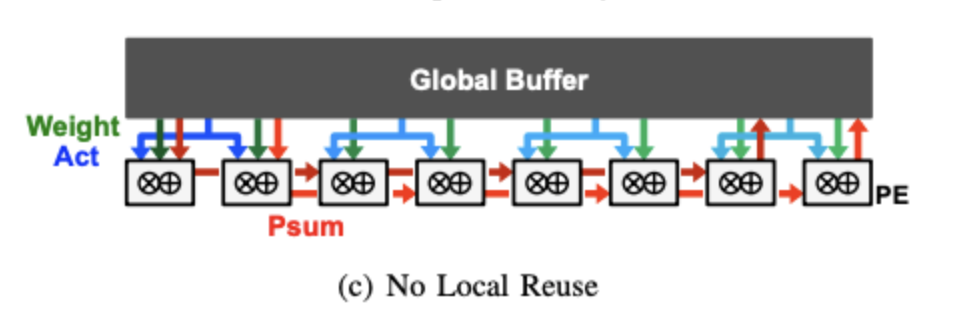

<!--
動機:小RF雖然存取省電,但每bit的面積效率差。
NLR的想法是與其讓面積分散在每個PE的小RF裡,不如集中省下來,
全部拿去做一個更大的Global Buffer,換取片上總容量變大、
減少去DRAM的次數。代價是所有存取都要經過6倍能耗的buffer
層級,沒有任何數據能停在最便宜的RF(1×)。
-->

---

<!-- _class: fig -->

## Dataflow:Row Stationary

固定住:**都顧一點**　牽動:三種reuse+partial sum

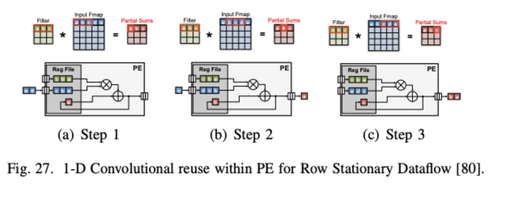

<!--
RS不追求任何單一數據類型最大化,而是
找weight+activation+partial sum三者加總起來最省電的平衡點。
-->

---

<!-- _class: fig -->

## RS Step 1:單一PE處理1-D Row

一整行filter權重焊死在PE的RF裡,input這一行流過去滑動

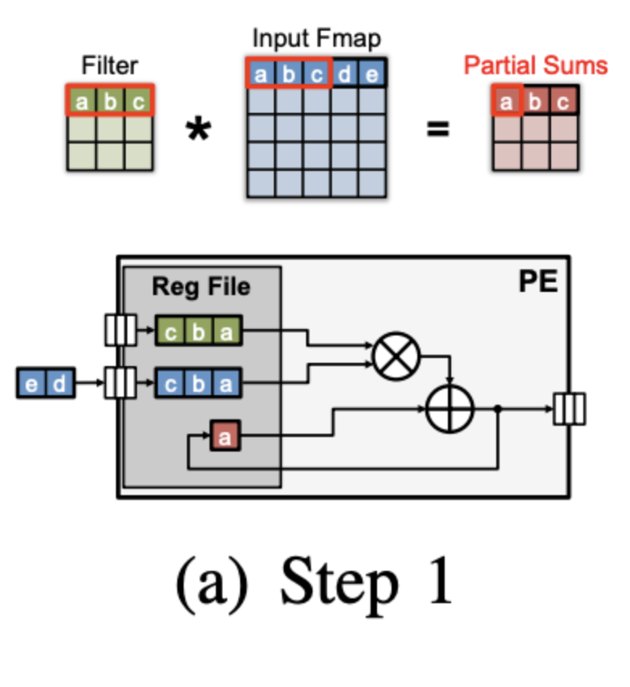

<!--
單一個PE負責filter的一行(比如3個權重),這行焊死在RF裡全程
不換。Input對應的那一行,依序滑過這個PE做窗口乘加——因為
filter這行不動,滑很多個位置時都在重複用同一組權重,這是
convolutional reuse。窗口滑動時會重疊,重疊的input數值也
留在PE內直接重用。Partial sum每算完一次直接留在PE內部同一
位置累加,不用搬出去——這個安排順便解決了OS想解決的問題,
不需要額外機制。
-->

---

<!-- _class: fig -->

## RS Step 1:單一PE處理1-D Row

一整行filter權重焊死在PE的RF裡,input這一行流過去滑動

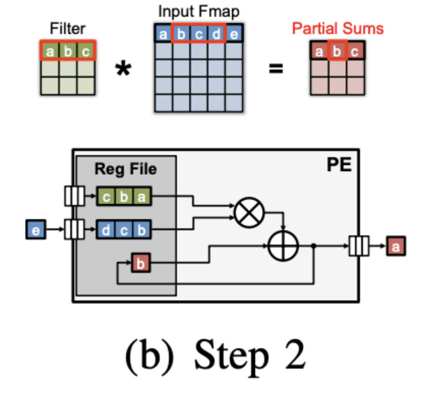

<!--
單一個PE負責filter的一行(比如3個權重),這行焊死在RF裡全程
不換。Input對應的那一行,依序滑過這個PE做窗口乘加——因為
filter這行不動,滑很多個位置時都在重複用同一組權重,這是
convolutional reuse。窗口滑動時會重疊,重疊的input數值也
留在PE內直接重用。Partial sum每算完一次直接留在PE內部同一
位置累加,不用搬出去——這個安排順便解決了OS想解決的問題,
不需要額外機制。
-->

---

<!-- _class: fig -->

## RS Step 1:單一PE處理1-D Row

一整行filter權重焊死在PE的RF裡,input這一行流過去滑動

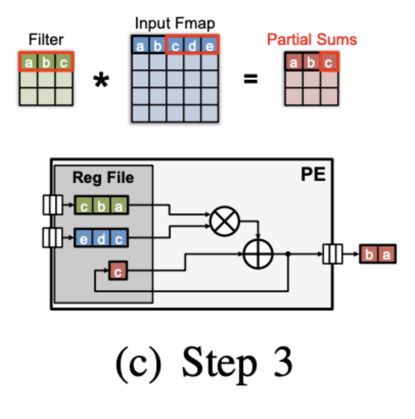

<!--
單一個PE負責filter的一行(比如3個權重),這行焊死在RF裡全程
不換。Input對應的那一行,依序滑過這個PE做窗口乘加——因為
filter這行不動,滑很多個位置時都在重複用同一組權重,這是
convolutional reuse。窗口滑動時會重疊,重疊的input數值也
留在PE內直接重用。Partial sum每算完一次直接留在PE內部同一
位置累加,不用搬出去——這個安排順便解決了OS想解決的問題,
不需要額外機制。
-->

---

<!-- _class: fig -->

## RS Step 2:多個PE組成2-D卷積

每組3個PE直排累加成一行output,可平行拓展成更多 column

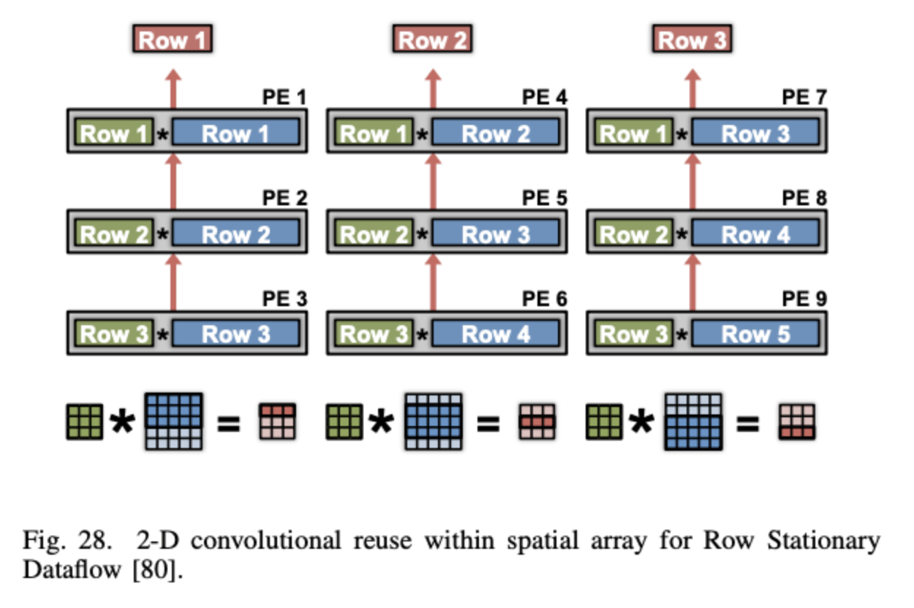

<!--
單一PE只能處理filter的一行,真正的filter有R行,需要R個PE
湊齊完整2-D卷積。做法:一個column裡3個PE垂直堆疊,各自對
filter row1/2/3配input row1/2/3,partial sum垂直累加,往上
吐出一整行output。同一橫排的PE用同一行filter(row1橫向被
PE1、PE4、PE7重複用);每往右一個column,input row往下移
一行。要產生更多output行,直接橫向增加column就好,可以
平行拓展。同一行input被相鄰column重複用,只需搬進buffer
一次,不用每個PE各自重搬。
-->

---

<!-- _class: fig -->

## RS Step 3a:塞入N、M維度

不同筆batch串接、不同filter交錯,流過同一個PE

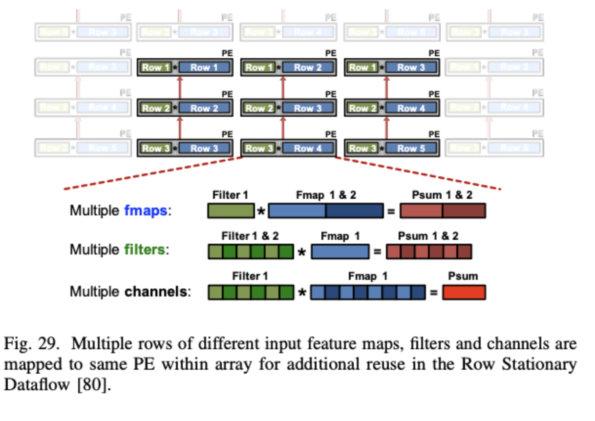

<!--
Step1、2只處理了一個filter、一個channel。如果要塞入batch(N)的話，
可以把不同筆input的同一行concatenate起來流過同一個PE,同一份filter row
被更多筆input重複用。另外還可以塞入filter數(M):不同filter
的同一行權重"交錯"流過同一個PE,同一行input留在RF不動,只換
filter,讓同一行input重複喂給不同filter。這裡的"交錯"發生
在RF內部,換的是filter不是input,省下的是input重複搬進RF
的次數。
-->

---

<!-- _class: fig -->

## RS Step 3b:塞入C維度

不同channel的filter row、input row交錯,partial sum在PE內加總

<!--
塞入channel(C):不同channel的filter row跟input row都交錯
進來,因為不同channel最後要加總成同一個output,這樣安排讓
partial sum的累加更多發生在PE內部,不用等到PE array層級
才加總。塞多少filter/channel/batch是programmable的,會用離線的
compiler依照RF容量跟模型shape算出最佳配置。
-->

---

<!-- _class: fig -->

## Eyeriss實測

同樣硬體面積(256 PE),AlexNet測試,batch=16

- CONV layer:RS比其他dataflow省 **1.4×–2.5×**
- FC layer:優勢縮小到 **1.3×**(reuse機會本來就少)
- RS的能耗集中在RF層級——代表大部分存取被壓到最便宜層級

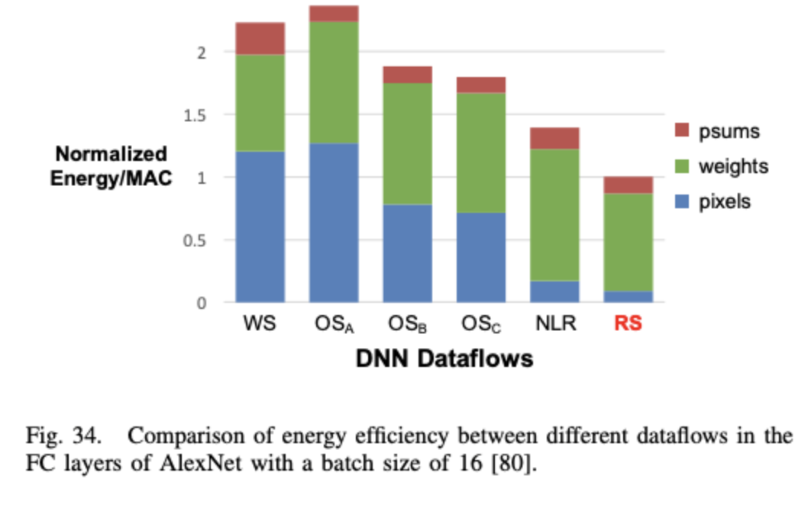

<!--
公平比較的前提:同樣面積、同樣256個PE,依dataflow需求分配
RF跟Global Buffer比例。WS/OS在各自主打的項目上確實最省,
但看總能耗,RS六種裡最低,因為它不是在單一項目做到極致,
而是weight/activation/partial sum三項都有不錯表現。FC layer
因為沒有convolutional reuse,reuse機會本來就少,RS優勢縮小,
呼應RS的優勢主要來自"同時兼顧多種reuse"這件事。整體而言
CONV layer佔了AlexNet約80%能耗,且趨勢是網路越深、CONV佔比
越高,所以硬體節能重點該持續放在CONV層。
-->

---

## 量化(1):8-bit定點

| 運算 | vs 32-bit定點 | vs 32-bit浮點 |
|---|---|---|
| Add | 3.3×能耗,3.8×面積 | 30×能耗,116×面積 |
| Multiply | 15.5×能耗,12.4×面積 | 18.5×能耗,27.5×面積 |

**乘法能耗/面積跟bit數平方成正比,加法只是線性**——降精度對乘法的效果更顯著

<!--
32-bit float動態範圍大,但電路複雜,因為要處理
指數對齊。定點數的f(小數點位置)固定,電路簡單但動態範圍
寫死了。Dynamic fixed point讓f可以按照層分別調整,解決不同
層數值範圍差很多的問題。實測下來，8-bit dynamic fixed point,不
fine-tune損失0.4%,fine-tune後0.6%——在中等壓縮程度下,
linear量化搭配dynamic fixed point已經很夠用,電路簡單是它
的優勢;只有追求更極端壓縮才需要更複雜的log/non-linear方案。
-->

---

## 量化(2):Binary/Ternary

| 方法 | Weight bits | 準確率損失 |
|---|---|---|
| BinaryConnect(±1) | 1 | 19.2% |
| Binary Weight Net(±w) | 1 | **0.8%** |
| Ternary(-w,0,w) | 2 | 3.7% |
| Trained Ternary Quant. | 2 | **0.6%** |

**±1讓乘法變加減法,但精度損失大;加一個縮放因子w就能救回大半準確率**

<!--
另外還有一種很激進的量化方法,binary quantization把weight
限制成±1,乘法直接消失變成加減法,電路省很多,但BinaryConnect
準確率損失19.2%,幾乎不能用。改進版BWN/XNOR-Net的關鍵是加
一個縮放因子,這個w是filter內權重絕對值的平均:算的時候還是
用±1做加減法省電路,算完把w乘回去,損失壓到0.8%。Ternary多
給一個0的選項,但要注意:0本身不會自動省電,硬體實作上要有
對應的跳過邏輯才有辦法省到電。
-->

---

## 量化(3):Non-linear — Log量化 + Weight Sharing

**Log量化**:level密度配合數據分布(0附近更密)

4-bit linear損失27.8% vs 4-bit log只損失5%

**Weight Sharing**:k-means分群,存index不存完整數值

CRSM×log₂U-bit(index) + U×16-bit(對照表) 遠小於 CRSM×16-bit

<!--
實際weight/activation分布集中在0附近,linear quantization
會浪費很多level在稀疏的區域。Log-based量化讓level密度配合
分布,密集區量化誤差變小。若level是2的冪次,乘法可以用bit-
shift取代,比真正乘法器省電。Weight Sharing則是另一條路:
用k-means或簡單的hash把權重分成幾群,同一群共用一個代表值,存的時候只
存"第幾群"的index,然後搭配查表。這個技巧不影響MAC運算本身的
精度,省的是"存權重"的成本,是跟前面"降bit數"完全不同的
省錢管道。
-->

---

## 剪枝(1):利用Activation稀疏性

ReLU天生製造大量0(AlexNet實測19%~63%稀疏度)

**0值的MAC結果不變,不需要真的執行**

- 壓縮存儲:run-length coding,只記非零值+跳過幾個0
- 跳過運算:偵測到0,直接skip讀weight+MAC

<!--
ReLU把負值砍成0,AlexNet實測feature map稀疏度19%~63%。0值
乘任何weight結果都是0,這次運算根本不需要執行。Run-length
coding只記錄[跳過幾個0,非零值]這樣的pair,可省2.1×
activation頻寬。跳過運算則是硬體偵測到activation是0,直接
跳過讀weight跟MAC,Eyeriss實測省45%能耗,更進一步連clock
cycle都跳過可以提升1.37×吞吐量。
-->

---

## 剪枝(2):Network Pruning

**網路訓練時通常過度參數化,很多weight是多餘的**

| 判斷標準 | 效果 |
|---|---|
| Magnitude-based(絕對值小就砍) | AlexNet權重砍到1/9 |
| Energy-aware(直接用能耗當標準) | 比magnitude-based多省**1.74×** |

**權重數量不是省能量的好指標——CONV能耗比FC高,即使FC權重數量遠多於CONV**

<!--
早期用saliency判斷,現代簡化成用絕對值大小,砍完fine-tune
恢復準確率。但權重數量不是能耗的好代理指標:FC權重多但CONV
能耗更高,因為能耗跟MAC運算量、記憶體存取模式有關,不只是
權重數量。Energy-aware pruning的做法是先建一個能耗估計
工具,考慮不同記憶體層級的存取次數、MAC數量、數據稀疏度,
拿這個真實能耗當剪枝標準,砍掉"對能耗貢獻大、但對準確率
影響小"的權重——結果比單純用magnitude當標準多省1.74×。
-->

---

<!-- _class: cover -->
<!-- _paginate: false -->

# Thanks!
