<!-- _class: cover -->
<!-- _paginate: false -->

# HiKV: Hierarchical Importance-Aware KV Cache with Hardware Acceleration for LLM Decoding

`KU Leuven` `ESAT-MICAS` `IEEE TCAS-I 2026`

Chao Fang, Jun Yin, Man Shi, Marian Verhelst

IEEE Transactions on Circuits and Systems I (TCAS-I), Vol. 73, Issue 10, Oct. 2026

arXiv 2607.22389

報告人：莊翔鈞

<!--
今天報告的這篇，是比利時 Leuven 大學團隊做的，第一作者是 Chao Fang，
發表在 IEEE TCAS-I 2026 年 10 月號。
它處理的是 LLM decode階段的 KV cache 讀取量，並且把算法實作到硬體上。
-->

---

## 背景：解碼一步在做什麼（attention）

```text
當前 token 產生 q_t, k_t, v_t        各 1 × d_h
K ← [K; k_t]    V ← [V; v_t]         cache 各多一個 row

S = q_t · Kᵀ    (1×d_h)(d_h×N) → 1×N    每個 token 一個分數
P = softmax(S)                    1×N    權重，加總 = 1
O = P · V       (1×N)(N×d_h)  → 1×d_h   輸出
```

<!--
decode 的時候 這一步產生的 k_t 和 v_t會append 到 cache 後面，K 和 V 各多一個 row。
q_t 跟 K 做內積，得到 S，再 softmax 變成權重，再跟 V 做矩陣乘法算出這一步的輸出，然後以上的步驟在每個head都獨立做。
-->

---

## 問題:每一步都要讀整個 KV cache

- 每一步解碼,都要從外部記憶體把 **所有 token 的 K 和 V** 讀進來
- KV cache 隨 **context 長度** 與 **batch** 線性成長
- 解碼是 GEMV,算得少、搬得多 → **memory-bound**

<!--
KV cache 是每條序列自己一份，所以 context 或 batch 變大之後，KV 的讀取量就會成為主要的瓶頸。
而且decode的運算是 GEMV，K 和 V 的每個元素讀進來只用一次，計算得少、搬運得多，所以是 memory-bound。
-->

---

## KV cache 壓縮：幾個流派

| 流派 | 做什麼 | 省的是 |
|---|---|---|
| Quantization | 降 KV 的 bit 數 | 頻寬 |
| **Token eviction** | 丟掉不重要的 token | 頻寬（可能也有容量） |
| Paging | 分頁管理，減少碎片 | 容量 |
| Prefix caching | 共用相同前綴 | 容量 |
| Heterogeneous tiering | 冷資料放較慢的記憶體 | 容量 |

<!--
KV cache 的壓縮有好幾個流派，有些省頻寬、有些省容量。
Token eviction 的想法是：cache 裡不是每個 token 都同樣重要，
所以只保留一部分 token 的 K 和 V，其餘的丟掉，之後不再讀。
-->

---

## 代表做法：S-LLM 與 H2O

| 方法 | 怎麼決定留誰 |
|---|---|
| S-LLM（StreamingLLM） | 序列最前面的幾個 sink token + 最近的視窗，不算分數，缺點是中間的資訊會整段丟掉 |
| H2O | 動態維護 attention 高的 token + 最近的 token，缺點是排序成本高 |

<!--
簡單介紹一下現行的兩種token eviction 的做法
S-LLM 的做法是靜態的：永遠只留序列最前面的幾個 token，再加上最近的一段視窗，不用算分數。
會留著前面token的原因是那一篇的作者發現，前幾個 token 會吸走很大一部分 attention，拿掉它們模型的輸出就會壞掉；
這個做法很 naive 而且很便宜，但中間的 context 會整段丟掉，所以在不少任務上 accuracy 掉很多。
H2O 是動態的：看每個 token 累積被 attention 關注的程度，留分數高的，再加上最近的 token，比較準，
但每一步都要維護分數與排序，成本不小。
-->

---

## HiKV 的想法:兩層壓縮

| | Stage I:token level | Stage II:element level |
|---|---|---|
| 砍什麼 | K、V 的 **row**(token) | QKᵀ 的 channel;PV 的 token row |
| 依據 | **IS**(累積的 attention) | q_t 的大小;P_t 的大小 |
| 性質 | **淘汰**,之後不再用 | **單步跳過**,下一步可能又被選中 |

兩層壓縮 **相乘**:讀取量約縮小 r_I × r_II 倍

<!--
這篇提出兩個層級的資料刪減。
Stage I 決定哪些 token 留在 cache 的 set 裡，被淘汰就不再參與。
他們砍的是 K 跟 V 的 row，刪減的依據是 importance score，之後會講怎麼計算。
Stage II 是在留下來的 token 裡，這一步只讀其中比較重要的數字，資料還在記憶體裡，下一步可能又被選中。
他砍的是 QKᵀ 的 channel，以及 PV 的 token row。注意這邊跟剛剛都砍了 V 的 row，但他只是在這一步 decode 沒被挑到，不是永久淘汰。
-->

---

## Stage I / II 不是前後兩段

**Stage 是砍的粒度，不是時間順序。一步解碼的順序，由資料依賴決定：**

```text
[Stage II-K：用 q_t 選 channel]      ← q_t 一開始就有
QKᵀ → softmax → P_t
[Stage I：更新 R 的 IS、淘汰]        ← 需要 P_t
[Stage II-V：用 P_t 選 row]          ← 需要 P_t
PV → O_t，新 token (K_t, V_t) 加進 R
```

<!--
論文裡提到的stage I/II 是在講刪減的粒度而不是順序，可以看到pseudo code裡面他們是交錯的
-->

---

## 符號（Stage I）

| 符號 | 意思 |
|---|---|
| r_I | Stage I 的壓縮倍率 |
| B_I | Stage I 保留的 token 數（= prompt 長度 / r_I，固定） |
| R | recent bank：最新的 B_I/2 個 token，FIFO |
| I | important bank：歷史上重要的 B_I/2 個 token |
| IS | importance score：累積的 attention 權重 |

<!--
先定義一下 stage I 會用到的符號。
r_I 是 stage I 壓縮的比例。r 應該是ratio
B_I 是 stage I 保留的 token 預算，也就是 budget
R 跟 I 分別是 recent 跟 important bank，簡單來說就是set 他們倆的大小各自是整體budget 的一半
IS 是 importance score，之後用它來決定哪些 token 能留在 important bank
-->

---

## Stage I：R 負責累加分數

- **R**：最新的 B_I/2 個 token，FIFO 的 sliding window
  - 每個新 token 在 R 裡存活 B_I/2 個 time unit，每個 time unit 把「當步 query 分給它的 attention 權重」累加上去
  - 被擠出 R 時，剛好累加了 B_I/2 次，得到 **IS**

<!--
R 是 FIFO 的 sliding window。也就是說每個新token 會被丟進來，他會存活 B_I/2 個步，之後被slide 出去
每一步都把那一步分給它的 attention 權重累加上去，
所以當它被 slide 出去的時候，剛好加總了 B_I/2 步的 attention，這個總分就是它的 IS。
這個分數是從 key 的角度算的，也就是後面的 token 總共給了它多少 attention。
-->

---

## Stage I：I 負責留住重要的 token

- **I**：歷史上 IS 最高的 B_I/2 個 token。**IS 凍結**
- 每步：R 最舊的 token 被擠出 → 和 I 裡 IS 最小的比
  - 比較大 → 進 I，最小的被淘汰
  - 否則 → 直接淘汰
- 參與 attention 的只有 **R ∪ I**（共 B_I 個）

<!--
R 是FIFO 所以每一步也會踢出一個老token，他會跟 I 裡面IS最小的token作比較 比他大就留下並淘汰小的 不然就淘汰自己
-->

---

## Stage I：為什麼凍結 I 的分數

- 好處：分數固定 → I 可以用 min-heap 維護，淘汰成本 O(log B_I)，不用像 H2O 每步重排
- 代價：進了 I 的 token 不會被重新評分
- 論文的理由：重要性具持續性（借自 Scissorhands）

<!--
這篇的分數計算在slide 出去的時候就凍結了，不像 H2O 那樣一直動態更新分數，
那就可以用我們資料結構學過的 min-heap 來維護 important bank，這在運算和電路上有不小好處。
-->

---

## Stage I：小例子

B_I = 4,I = {a: 0.9, b: 0.2},R 裡有 c、d

1. c 在 R 裡被後面兩步各分到 0.10、0.30 → IS(c) = 0.40
2. 新 token e 進 R,c 被擠出
3. 0.40 > min(I) = 0.2(b)→ **c 進 I,b 被淘汰**
4. a 之後可能繼續被大量參考,但它的分數 **永遠停在 0.9**

<!--
這個例子裡 a 就是凍結的缺點：它的分數是歷史值，之後就算沒人看它了，
它也會一直留在 I 裡，除非有人比 0.9 更高才會被擠掉最小的那個。
-->

---

## 符號（Stage II）

| 符號 | 意思 |
|---|---|
| d_h | 一個 head 的向量長度 |
| N | Stage I 之後留下的 token 數 |
| r_II | Stage II 的壓縮倍率 |
| B_II | Stage II 每次保留的數量（= d_h / r_II） |
| q_t | 第 t 步的 query（1 × d_h） |
| P_t | 第 t 步 softmax 後的權重（1 × N） |

<!--
接著是 Stage II 的符號。
d_h 是一個 head 的dimension。
N 是 Stage I 之後留下的 token 數。
r_II 是 Stage II 的壓縮倍率，
B_II 是 Stage II 每次保留的數量：K 側是留幾個 channel，V 側是每組留幾個 token
-->

---

## Stage II：砍 K 的 column（channel）

**按照 q_t 的絕對值篩選 channel：只讀 |q_t| 最大的 B_II 個 channel**

例（d_h = 4，B_II = 2）：

q_t = [0.1, 3.0, −0.2, 2.0]，|q_t| = [0.1, **3.0**, 0.2, **2.0**] → 留 c2、c4

```text
K          c1  c2  c3  c4
token 1     ·   ■   ·   ■
token 2     ·   ■   ·   ■   ■ = 要讀
token 3     ·   ■   ·   ■
```

<!--
Stage II 會刪 K 的 channel，刪減的依據是 q_t 裡數字小的 channel，因為乘出來的貢獻也小，所以賭它可以不讀。
取絕對值是因為正負號只決定貢獻的方向，大小才決定貢獻多寡。
-->

---

## Stage II：砍 V 的 row（token）

**按照 P_t 的大小篩選 token：只讀 P_t 最大的 B_II 個 token 的 V row**

例（N = 4，B_II = 2）：

P_t = [**0.60**, **0.30**, 0.07, 0.03] → 留 token 1、token 2

```text
V          c1  c2  c3  c4
token 1     ■   ■   ■   ■   P = 0.60
token 2     ■   ■   ■   ■   P = 0.30    ■ = 要讀
token 3     ·   ·   ·   ·   P = 0.07
token 4     ·   ·   ·   ·   P = 0.03
```

<!--
另外 stage II 還刪了 V 的 token row。這跟 Stage I 砍的是同一個維度。
差別有兩個：Stage I 把 token 踢出 R 跟 I 就永遠淘汰，不再參考；Stage II 是直接看這一步 P_t 的值，這步沒被挑到，token 還在 R ∪ I，下一步 P_t 變了可能又被選中。
-->

---

## Stage II：V 側分組挑 token

- 問題：從 N 個權重挑最大的 B_II 個，全域排序是 O(N log N)，難以平行
- 做法：每 128 個（= d_h）token 分成一組，**每組各挑 B_II 個**
- 複雜度 O(N log d_h)，各組可平行

縮小版的例子（每 4 個一組，N = 8，B_II = 2）：

P_t = [0.35, 0.30, 0.20, 0.05 | 0.04, 0.03, 0.02, 0.01]

→ 第 1 組挑 token 1、2，第 2 組挑 token 5、6

<!--
剛剛提到stage II 要挑前幾個權重，把整個 P_t 排序好的話，時間複雜度是O(N log N)而且很難平行。
所以作者改成每 128 個 token 分成一組，每組各自挑而且平行做。
-->

---

<!-- _class: fig -->

## Stage II：分組挑選的代價

- 代價：近似。每組強制保留 B_II 個，大權重集中在同一組時會被擠掉
- 論文 Fig. 7：與全域排序相比，召回率 > 95%（r_I = 4×、r_II = 2×）

上一頁的例子：全域最大的 4 個是 token 1、2、3、4，分組只挑到 token 1、2、5、6
→ 0.20 的 token 3 被擠掉，換進兩個只有 0.04、0.03 的

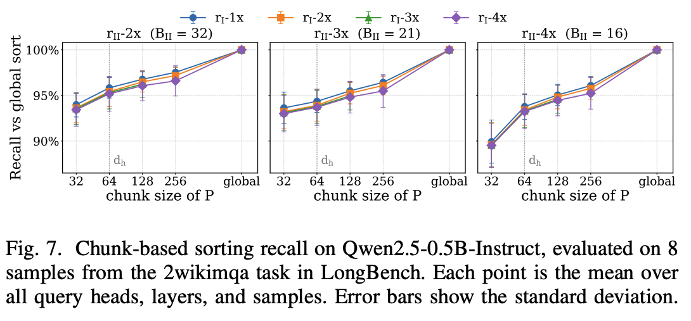

<!--
上一頁提到的分組做排序是為了硬體友善做的近似。每組強制保留一樣多，有可能某一組的大權重被擠掉，所以他們用召回率來量化這個誤差。跑過之後作者召回率高於95%
-->

---

## 兩層合起來：讀取量相乘

**讀取量縮小 r_I × r_II 倍**

例：K 是 8 token × 4 channel（32 格）
- Stage I 留 4 個 token → 讀 4 個 row（r_I = 2）
- Stage II 留 2 個 channel → 每個 row 只讀 2 格（r_II = 2）
- 實際讀 4 × 2 = **8 格**，少 4 倍

**注意**：這是 **讀取量**，不是儲存容量

<!--
K 側是先砍 row 再砍 column，V 側是兩次都砍 row，
兩層互不干擾，所以讀取量相乘。兩個都是近似，誤差也會疊加。
-->

---

## 初始化：用 prefill 的結果

- 最後 B_I/2 個 token → **R**
- 其餘 token 中，IS 最高的 B_I/2 個 → **I**
- IS 直接從 prefill 的 attention 矩陣算：那個 token 的 column 往下 B_I/2 個 row 的加總

<!--
另外，這篇講的都是decode的優化，壓縮是 prefill 做完之後才開始的，prefill 本身是完整計算 attention，這篇沒有特別省到。
R 是最新的 B_I/2 個 token；其餘 token 裡 IS 最高的 B_I/2 個放進 I。
額外成本只是一次排序，相對 prefill 本身的 O(prompt 長度的平方) 可以忽略；論文也說在長 context 下，prefill 只占總推論時間的一小部分。
-->

---

<!-- _class: fig -->

## 硬體：系統架構總覽

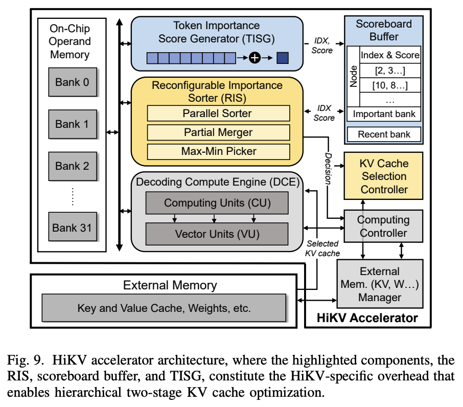

<!--
這是整個加速器架構。
RIS 是 reconfigurable importance sorter，負責做 sorting，協助維護 heap，後面會提到。
TISG 是 token importance score generator，就是 512 個 FP16 加法器，把 P_t 累加到 R 裡每個 token 的 IS 上，只有 Stage I 用到。
Scoreboard 存的是 index 和 IS也就是metadata 而已，完整的 K、V 都在外部記憶體。
DCE 是 decoding compute engine，負責做 GEMV 跟 softmax。
圖左邊的 operand memory 是 32 個 bank 的 on-chip SRAM，共 2 MB，放載入的 K、V、q、P 等中間資料，其實就是 global buffer。
-->

---

## 什麼是 bitonic？

**bitonic 序列：先升後降**

例：[1, 3, 6, 8, 7, 5, 4, 2]

<!--
bitonic 就是先升後降的序列，像這個例子是 1、3、6、8 往上，再 7、5、4、2 往下。
bitonic sorter 就是利用這種序列的特性來排序，下一頁看它的基本單元。
-->

---

<!-- _class: fig -->

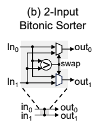

<!--
這個是 RIS 最底層的基本單元，叫 2-input bitonic sorter，其實就是 compare-and-swap：一個比較器加一個交換單元。
兩個輸入進來比大小，依照比較結果，把較大的和較小的送到指定的輸出。
RIS 裡的三個模組，都是用這個單元用不同的接法堆出來的。
-->

---

<!-- _class: fig -->

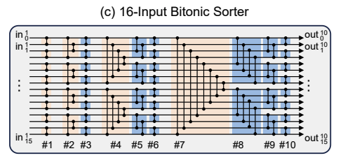

<!--
這是用前面的 2-input 單元，照 bitonic sorting network 的接法堆出來的 16 輸入排序器。
一共 80 個 2-input 單元，切成 10 級。圖中橘色那一級的輸入是兩個升冪序列，輸出是兩個 bitonic sequence；再經過藍色的幾級，輸出就是一個完整的升冪序列。
把兩個16-input sorter拼在一起就是Parallel sorter，可以同時處理兩個獨立的 16 個數。
輸出端用一個控制訊號決定要不要把升冪反轉成降冪。需要它的原因是下一個模組會用到。
-->

---

<!-- _class: fig -->

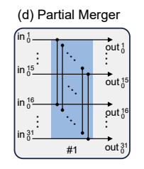

<!--
Partial merger 吃兩條排好的序列，一條升冪、一條降冪，各 16 個，拼起來就是 bitonic。
它只做一級比較：第 i 個跟第 i 個兩兩比，大的送到上面，小的送到下面。
結果是上面輸出就是最大的 16 個，下面是最小的 16 個，但各組內部不再排序。
論文說這是刻意的設計，因為後面只需要找到邊界值，完整排序組內會多花電路。
-->

---

<!-- _class: fig -->

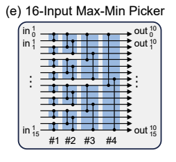

<!--
Max-min picker 的輸入是 partial merger 吐出來的一組 16 個數，組內是無序的。
它負責把這 16 個裡的最小值和最大值找出來，放在頭和尾。
用的還是 2-input sorter，一共 4 級比較。
中間的 14 個一樣不排序，因為後面的 heap 和選擇只需要邊界值。
-->

---

<!-- _class: fig -->

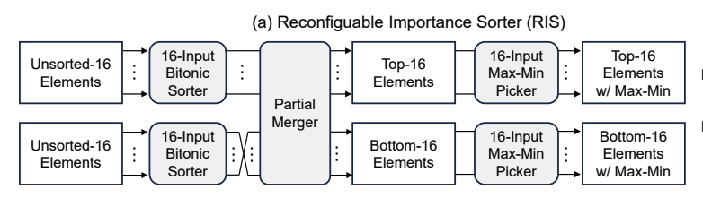

<!--
前面講的三個模組拼在一起就是完整的 RIS。
輸入是兩組各 16 個、無序的數。先過 parallel sorter，兩組各自排好，其中一組反轉成降冪。
接著 partial merger 一級比較，分出最大的 16 個和最小的 16 個。
這兩組各自再過一個 max-min picker，把各自的最小值和最大值放到頭尾。
critical path 是 10 + 1 + 4 = 15 級
-->

---

<!-- _class: fig -->

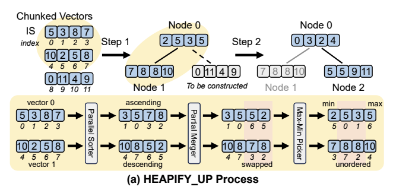

<!--
important bank 是 min-heap，但每個 node 存的是一個 vector，圖上為了簡化用 4 個一組。
這樣一次比較就能用 RIS 的平行比較網路處理整個 node。
HEAPIFY_UP 用在 prefill 結束後建 heap
（看圖講就好）
新 node 加進來時，一路往上跟 parent 重複這個比較，直到這個 node 的 最小值 不小於 parent 的 最大值 為止。
這是一次性的 prefill 成本，會被後面所有的 decode 步攤掉。
-->

---

<!-- _class: fig -->

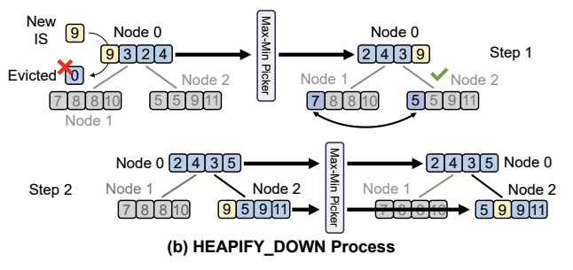

<!--
R 踢出最老的 token 時，要決定它能不能換掉 I 裡最小的元素。
root 的 最小 和 最大 位置都已知，所以分兩種情況。
這個 token 的 IS 小於 heap 裡最小值，這個 token 就直接丟掉。
否則就加入 heap。
（中間的步驟照圖裡講）
一路往下，直到目前 node 的 最大 不大於兩個 child 的 最小 為止。
整個過程只走一條 root 到 leaf 的路徑，而且 parallel sorter 和 partial merger 都 bypass，只開 max-min picker，所以每步很便宜。
-->

---

<!-- _class: fig -->

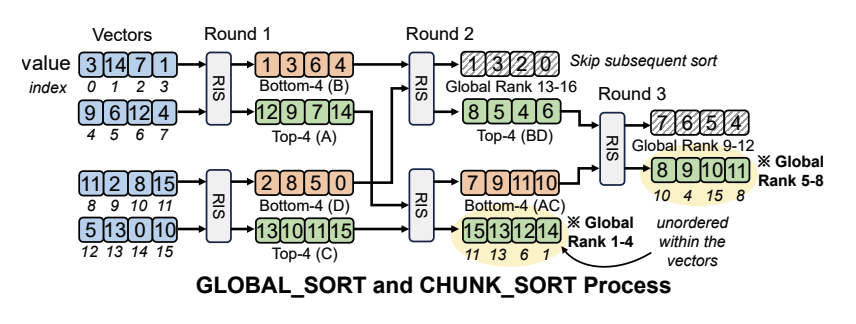

<!--
Stage II 要從一組元素裡挑出最重要的 top-B_II 個，用的就是RIS 的排序功能。
（例子照圖講：16 個裡挑 top-8，3 輪共 5 次 RIS 呼叫。）
排完之後，區間之間有高低順序，區間內部不排序。
確定整個落在 top-B_II 之外的區間，就不再呼叫 RIS。
選出來的 top-B_II mask 由 KV cache selection controller 產生，用來控制從 DRAM 讀哪些 channel 或 token。
-->

---

## Scoreboard：只存 index 和 IS

| 區域 | 結構 | 存什麼 |
|---|---|---|
| recent bank（R） | FIFO | 最近 B_I/2 個 token 的 index 和累加中的 IS |
| important bank（I） | min-heap（register array） | B_I/2 個 token 的 index 和凍結的 IS |

**8 × 64b × 2K = 128 KB，0.138 mm²（6.70%）、7.42 mW（5.48%）**

<!--
Scoreboard 是 Stage I 的記帳本，分成 recent bank 和 important bank 兩塊，剛好對應演算法裡的 R 和 I。
它只存 token 的 index 和 IS，不存 KV 本身，完整的 KV 都在外部記憶體。
recent bank 是 FIFO，important bank 是 min-heap 形式的 register array（論文原文）。至於 128 KB 的 scoreboard 實體上是 SRAM macro 還是 flip-flop，論文沒有細講。
這些 index 還有第二個用途：用來告訴 external memory manager 要去 DRAM 讀哪些 token。
面積和功耗上，Scoreboard 是 HiKV 專屬硬體裡最大的一塊：0.138 mm²（6.70%）、7.42 mW（5.48%），RIS 只有 1.51% 和 1.43%。
-->

---

<!-- _class: fig -->

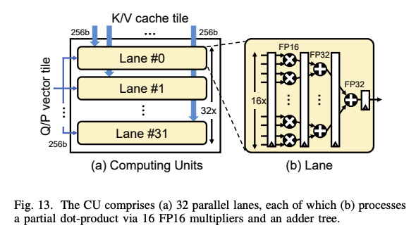

<!--
最後是計算的部分
Computing Unit 負責做GEMV，有 32 條平行的 lane。
每條 lane 有 16 個 FP16 乘法器和一棵 adder tree，輸出一個 FP32 的 partial dot product。
每次一個 Q 或 P 的 16 個元素 tile 廣播給所有 lane，每條 lane 各自拿到不同的 K 或 V 的 16 個元素 tile。
RIS 的 mask 決定哪些 K 或 V 要進來，沒被選中的不讀也不算，所以 DRAM 傳輸量和乘加量都按比例減少。
-->

---

## K / V 在 DRAM 上的排法

| | K cache | V cache |
|---|---|---|
| 排法 | column-major：同一個 column（channel）在所有 token 上的值連續放 | row-major：同一個 row（token）的值連續放，token 依位置排 |
| Stage II 讀的 | B_II 個 column | 每個 chunk 的 B_II 個 row |
| 結果 | B_II 段完全連續的 burst | 選到的 token 可能分散在不同 DRAM row |

<!--
K 和 V 在 DRAM 上用不同的排法，原則是 Stage II 挑什麼，就按什麼連續放。
K 側挑的是 column（channel），所以同一個 column 在所有 token 上的值連續放，挑出 B_II 個 column 就是讀 B_II 段連續的資料。
V 側挑的是 row（token），所以每個 token 的值連續放，token 依位置排。每 d_h 個 token 一組，每組只讀被選中的 B_II 個。
代價：V 被選中的 token 不一定相鄰，最壞情況落在不同的 DRAM row，每次都要 row miss。
-->

---

## 實驗設定：算法

| 項目 | 設定 |
|---|---|
| 模型 | mistral-7b-instruct-v0.2、llama3-8b-instruct、longchat-7b-v1.5-32k、qwen2.5-0.5b-instruct |
| Benchmark | LongBench 的 10 個任務；prefill 固定 4096 tokens，batch = 1 |
| 掃描範圍 | r_I、r_II 各 1× 到 4×，r_total = r_I × r_II |
| Baseline | vanilla（FP16 全部 KV，不淘汰也不選擇）、S-LLM、H2O |
| 合格條件 | 相對 vanilla 的 accuracy 下降不超過 1% |

<!--
先看算法層：accuracy 能不能保住。
用四個模型、LongBench 的 10 個任務，掃描 r_I 和 r_II，以 accuracy 掉不超過 1% 為合格條件。
-->

---

<!-- _class: fig -->

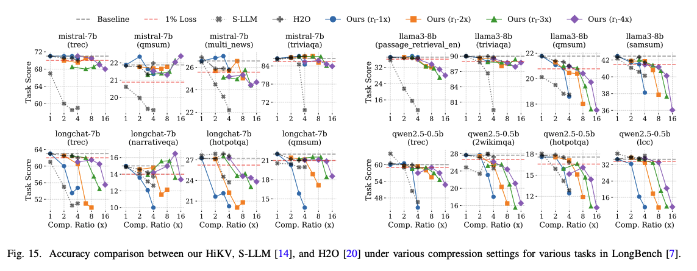

<!--
這張圖是 accuracy 對總壓縮比 r_total 的曲線，4 個模型各 4 個任務，一共 16 張小圖。
灰色虛線是 vanilla 的分數，紅色虛線是掉 1% 的門檻，曲線要在紅線以上才算合格。
S-LLM 和 H2O 只做 token 層，r_total 就是 r_I。HiKV 有四條線，各自固定 r_I 為 1× 到 4×，沿著 x 軸增加 r_II，所以 r_total = r_I × r_II。
S-LLM 很快就掉到紅線以下，有些任務連最小的壓縮比都過不了。
HiKV 跟 H2O 大致在同一梯隊，只要不壓過頭，accuracy 都守得住。HiKV 真正的好處不在這張圖，會在後面的硬體、記憶體存取和功耗上顯現。
-->

---

## 硬體實作：面積與功耗

**Verilog，TSMC 16 nm，300 MHz，0.8 V，post-layout**

| 模組 | 規格 | 面積（mm²） | 功耗（mW） |
|---|---|---|---|
| Operand memory | 32 × 128b × 4K（2 MB） | 1.710（83.1%） | 69.0（51.0%） |
| CU | 512 FP16 MAC | 0.141（6.85%） | 54.9（40.5%） |
| VU | 64 × FP32 FPU | 0.028（1.36%） | 2.01（1.48%） |
| **Scoreboard** | 8 × 64b × 2K | 0.138（6.70%） | 7.42（5.48%） |
| **RIS** | 16-parallel sorter | 0.031（1.51%） | 1.93（1.43%） |
| **TISG** | 512-dim adders | 0.009（0.44%） | 0.14（0.10%） |
| 其他 | Control 等 | 0.002（0.10%） | 0.03（0.02%） |
| 總計 | | 2.059 | 135.4 |

粗體是 HiKV 專屬：**8.64% 面積、7.01% 功耗**

<!--
先看硬體層：HiKV 多出來的硬體代價有多大。
整顆晶片 2.059 mm²、135.4 mW。大頭是 operand memory，佔 83.1% 的面積和 51.0% 的功耗；計算單元面積只有 6.85%，但功耗佔 40.5%。
HiKV 專屬的三塊是 Scoreboard、RIS 和 TISG，加起來只有 8.64% 的面積和 7.01% 的功耗。
RIS 這麼小，是因為同一個電路用控制訊號切換，就能支援前面講的 Stage I 和 Stage II 的四種模式。
-->

---

## 實驗設定：系統

| 項目 | 設定 |
|---|---|
| 外部記憶體 | HBM2：1024-bit、256 GB/s、3.9 pJ/bit，用 DRAMSim3 模擬 |
| 效能模型 | LLM-Viewer 建模 decode 階段，並帶入前面合成出來的面積與功耗 |
| 公平比較 | 所有方法統一平台：512 FP16 MAC + 2 MB SRAM |
| Baseline | vanilla、S-LLM、H2O、Token-P |
| 壓縮設定 | 每個方法取「平均分數在 vanilla 的 1% 以內」下最激進的設定；做不到就退回不壓縮 |
| 量測 | 外部記憶體存取、推論速度、能耗 |

<!--
再看系統層：用同一個硬體平台比較各方法。
所有方法都放在 512 個 FP16 MAC 加 2 MB SRAM 的平台上，這樣差異就只來自方法本身，不是硬體假設不同。
作者應該是在這個限制下，按照各篇原文的想法實作 S-LLM、H2O 和 Token-P，再把合成出來的數字丟進 LLM-Viewer 跑；論文沒有寫 baseline 實作的細節。
每個方法都取在 accuracy 掉不超過 1% 的條件下最激進的壓縮設定，做不到就退回不壓縮。
-->

---

<!-- _class: fig -->

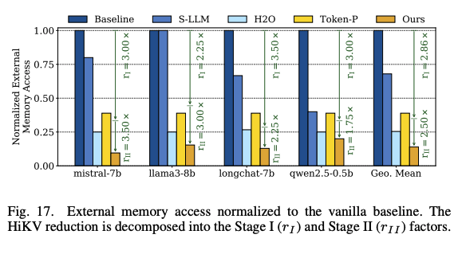

<!--
這張圖是外部記憶體存取量，以 vanilla 為 1 做比較，在 1% accuracy 條件下比較。
可以發現這些方法都能有效壓低 memory access。但 S-LLM 在 llama3-8b 上完全沒有減少，因為它在那個模型上連最小的壓縮比都過不了 1% 的條件。
-->

---

<!-- _class: fig -->

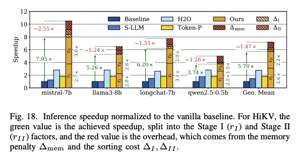

<!--
這張圖是推論速度，以 vanilla 為 1 做比較。HiKV 的 bar 上，綠色是實際達到的加速，並拆成 Stage I 和 Stage II 兩個因子；紅色是額外開銷。
HiKV 在 attention 部分平均加速 5.70×，比前面記憶體存取減少的 7.17× 低一點，因為多了排序和記憶體存取的開銷。
開銷裡最大的是 Stage II 細粒度存取造成的 memory penalty，RIS 的排序成本只佔約 8%，而且大多被這個記憶體存取遮蔽掉。
-->

---

<!-- _class: fig -->

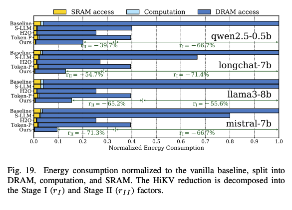

<!--
這張圖是能耗，以 vanilla 為 1 做比較，拆成 DRAM、SRAM 和運算三塊。
vanilla 裡 DRAM 就佔了 96% 以上，所以能耗要降，主要就是減少 DRAM 搬運。
HiKV 在所有模型上省 80% 到 90% 的能耗。晶片上的運算和 SRAM（包含 RIS）只佔總能耗約 4%，新增的硬體對能耗的影響很小。
-->

---

## 總結

- 觀察：KV cache 的冗餘同時存在於 token 和 element 兩個粒度
- 方法：Stage I 淘汰 token（recent bank + 凍結分數的 important bank），Stage II 每步挑 channel 與 token，讀取量相乘
- 硬體：RIS 一個電路支援兩層，只多 8.64% 面積、7.01% 功耗
- 結果：記憶體存取剩 13.94%（7.17×），attention 部分平均加速 5.70×，能耗省 80% 到 90%

<!--
總結一下。
這篇的核心觀察是 KV cache 的冗餘有兩層：token 層和 element 層。
Stage I 在 token 層淘汰不重要的 token，Stage II 在每一步只讀重要的 channel 和 token，兩層的節省是相乘的。
硬體上，RIS 用同一個電路支援兩層需要的排序，整個 HiKV 只多了 8.64% 的面積和 7.01% 的功耗。
結果是外部記憶體存取降到 vanilla 的 13.94%，attention 部分平均加速 5.70×，能耗省 80% 到 90%。
跟其他 token-level 的加速器比，記憶體存取減少大約在 2.57× 到 5×，HiKV 是 7.17×。
-->

---

<!-- _class: cover -->
<!-- _paginate: false -->

# Thanks!


---

## 備用：與 SotA 加速器比較（Table II）

| 設計 | 粒度 | 實作 | 面積 mm² | 功耗 mW | 存取減少 |
|---|---|---|---|---|---|
| Token-Picker | token | pre-layout | 0.45 | 1136 | 2.57× |
| Titanus | element | pre-layout | 112.3 | 36,016 | 2.4× |
| KV-MMU | token | pre-layout | 2.63 | N/A | 2.6× |
| MATA | token | pre-layout | 1.42 | 297.2 | ∼4.09× |
| VEDA | token | pre-layout | 0.33 | 241.8 | 5× |
| **HiKV** | **hierarchy** | **post-layout** | 2.059 | 135.4 | **7.17×** |

面積、功耗已用 DeepScaleTool 換算到 16 nm

> 單一粒度的壓縮有上限；兩層合起來才做到最高的記憶體存取減少

<!--
這頁是備用，被問到跟其他加速器比的時候用。
Token-level 的方法減少量大約在 2.57× 到 5×，原因是留下來的 token 還是要整個讀進來，token 裡面 element 層的冗餘沒有處理。
Titanus 有做 element 層，但沒有 token 層的粗粒度篩選，記憶體存取只減少 2.4×，比好幾個只做 token 的設計還低。所以論文的結論是，單一粒度的壓縮不管選哪一層都有上限。
HiKV 兩層都做，7.17× 是表裡最高的。論文另外說，在同樣 accuracy 限制下，比 SotA 多出 1.82× 到 4.87× 的記憶體存取減少。
面積和功耗：HiKV 不是最小的。換算到 16 nm 之後，VEDA 0.33 mm²、Token-Picker 0.45 mm² 都比 HiKV 的 2.059 mm² 小；功耗 HiKV 的 135.4 mW 是表裡最低，但 Token-Picker 和 KV-MMU 的數字不是同一個比較基準。HiKV 的優勢主要是記憶體存取減少，不是面積。
要注意這張表不是同條件比較：其他設計大多是 pre-layout，HiKV 是 post-layout，post-layout 的面積和功耗通常比較大；MATA 的 4.09× 是論文自己用 SpAtten 的數字換算估計的；各篇的任務、baseline、精度也不一樣。
-->