<!-- _class: cover -->
<!-- _paginate: false -->

# Oaken: Fast and Efficient LLM Serving with Online-Offline Hybrid KV Cache Quantization

`KAIST` `HyperAccel` `ISCA 2025` `arXiv 2503.18599`

Minsu Kim, Seongmin Hong, RyeoWook Ko, Soongyu Choi, Hunjong Lee, Junsoo Kim, Joo-Young Kim, Jongse Park

報告人：莊翔鈞

<!--
今天報告的這篇，是韓國 KAIST 和 KAIST 衍生的 HyperAccel 硬體新創合作的，發表在 ISCA 2025。 第一作者是 Minsu Kim 和 Seongmin Hong。 它處理的是 LLM inference 在大 batch 下，KV cache 同時吃bandwidth和capacity的問題，做法是 KV cache 量化，而且演算法和硬體是一起設計的。
-->

---

## Batching：weight 共用，KV 不共用

decode 每一步，每個 request 各產生 1 個 token

| 運算 | 運算元 | 跨 request |
|---|---|---|
| QKV 生成、Projection、FFN（activation-weight） | weight | **共用**：讀一次，整個 batch 一起用 |
| Q×Kᵀ、S×V（activation-activation） | 每個 request 自己的 K、V | **不共用**：各讀各的 |

<!--
這篇處理的場景是 LLM serving，而且鎖定的是 decode，雖然 Oaken 可以做 prefill，但只是能用而已，沒有做特別的優化。
為了提高 throughput，會把多個 request 合成一個 batch 一起算。
在 decode 階段，每一步每個 request 各產生一個 token。
Attention 是 activation 乘 activation，K 和 V 是每個 request 自己的 KV cache，沒辦法共用，每個 request 各讀各的。
其他的 QKV 生成、projection 和 FFN 則可以共用 weight，讀進來一次，batch 裡所有 request 都能用。
-->

---

## Batch size 越大，讀取量越被 KV 主導

每個 token 平均讀取量（簡化模型）：

$$\frac{\text{weight}}{\text{Batch size}} + \text{K} + \text{V}$$

> weight 是共用的，會被 batch size 攤薄；每個 request 的 KV 是獨立的，攤不掉

<!--
對於每個 request 的每個 token，讀取量大概可以簡化成上面這個公式，batch_size 變大之後 weight 就可以被均攤掉，變成 KV 主導。
-->

---

<!-- _class: fig -->

## Bandwidth 與 Capacity：HBM 與 LPDDR 的取捨

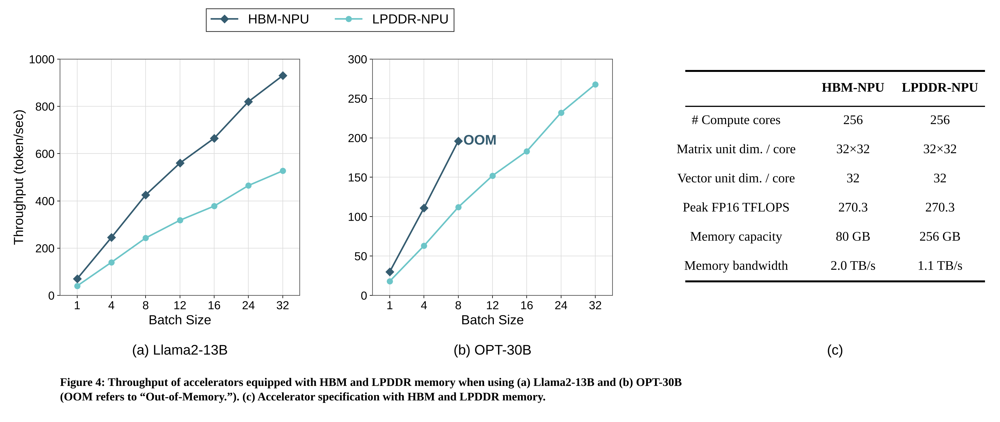

<!--
作者用同一個 NPU 分別接 HBM 和 LPDDR，在 Llama2-13B 和 OPT-30B 上比較 throughput。HBM 的 bandwidth 高，模型小的時候最快；但 capacity 小，OPT-30B 在 batch 8 就 OOM，這時候 LPDDR 因為 capacity 大，可以跑更大的 batch，反而最快。
所以只靠選記憶體沒辦法都要，這就是為什麼作者要用量化，同時降低 KV cache 的 capacity 和 bandwidth 需求。
-->

---

## 現有 KV 量化的取捨

| 方法 | effective bitwidth | accuracy | overhead |
|---|---|---|---|
| QServe、Atom、Tender（channel grouping） | 低（4.1–4.3） | 有些掉 | reordering |
| KIVI、KVQuant（outlier 獨立處理） | 高（4.8–5.0） | 最好 | sorting、mixed-precision |
| Oaken | 4.8–4.9 | 接近 KIVI、KVQuant | 低 |

<!--
已經有不少 KV cache 量化的工作，但各自有問題。
第一類是 QServe、Atom 和 Tender，做法是 channel grouping，把大小相近的 channel 分成一組一起量化，分組前要先做 channel reordering，把 channel 重新排列。問題是 quantization granularity 比較 coarse，accuracy 會下降，而且 reordering 本身有 runtime overhead。
第二類是 KIVI 和 KVQuant，做法是 per-vector 的 mixed-precision，把 outlier channel 獨立出來用高精度處理。這樣 accuracy 損失小，但要做 sorting 或 mixed-precision 的運算，overhead 很大，把量化帶來的 throughput 收益大部分抵銷掉了。
所以作者歸納出兩個需求：第一，要用很低的 bitwidth，accuracy 還不能掉；第二，低 bitwidth 要真的在硬體上轉成 throughput 的提升，不能被 overhead 吃掉。這就是 Oaken 要達成的目標。
-->

---

<!-- _class: fig -->

## KV 分布的觀察：數值範圍

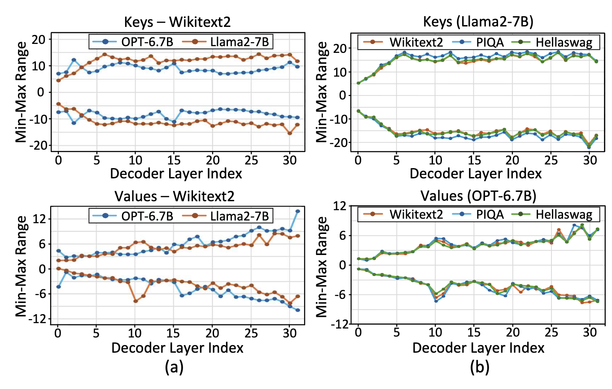

1. 每個 model、每個 layer 各自決定參數
2. 參數跟輸入資料無關

<!--
作者在 KV cache 裡面發現三個規律。
第一，不同 model 的數值範圍不一樣，同一個 model 裡不同 layer 的範圍也不一樣，所以 quantization 的參數要針對每個 model、每一層各自決定。
第二，同一個 model，不同 dataset，每一層的範圍幾乎一樣。所以參數不需要跟著輸入的 prompt 變，每一層用一組就好。
-->

---

<!-- _class: fig -->

## KV 分布的觀察：大值的位置

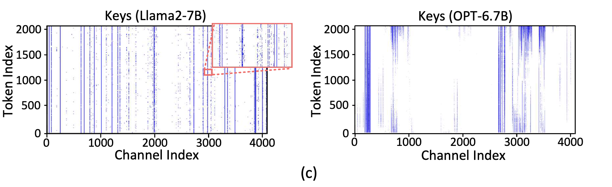

3. 同一個 vector 內依數值大小分多組

<!--
第三，前 4% 大的值大多集中在特定的 channel，所以過去的工作才會用 per-vector 或 per-vector-group 的量化。
但圖上有不連續的線和點，是這個規律的例外，單一 scale 會讓 accuracy 掉，所以要在 vector 內分多組。
-->

---

<!-- _class: fig -->

## Offline threshold profiling

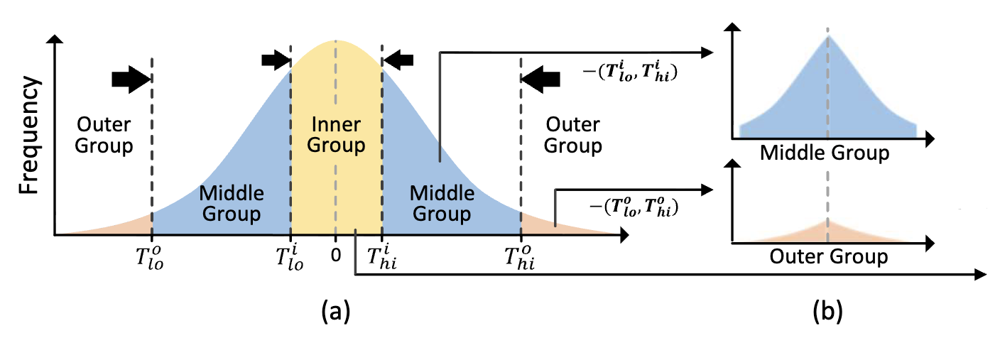

- 4 個 threshold 把數值切成 outer、middle、inner 三組：$T^o_{lo},\ T^i_{lo},\ T^i_{hi},\ T^o_{hi}$
- topK 找 inner、outer 等於 sorting，$O(n \log n)$，inference 時做太貴
- 改成 offline：約 100 次 inference，每層取 topK，再平均出 threshold

<!--
前面提到的規律說，一個 vector 裡要依數值大小分成多組。Oaken 分成三組，叫 outer、middle、inner，看 Fig 7 的 (a)。x 軸是數值，y 軸是頻率，中間是 0。
inner 在最中間，是數值很接近 0 的那組。outer 在最兩側，是絕對值很大的那組。middle 在 inner 和 outer 之間，是大部分的值。
四個 threshold 把數軸切成五段，歸成三組：outer 的下界和上界，T^o_lo 和 T^o_hi，還有 inner 的下界和上界，T^i_lo 和 T^i_hi。
找 inner 和 outer 常見的做法是 topK，固定取一個比例的值。但 topK 本質上是 sorting，複雜度 O(n log n)，在 inference 的時候做，overhead 很大。
Oaken 利用 KV 的分布不隨輸入改變的特性，把 threshold 先 offline 做好。那做法是拿大約一百筆 sample prompt 跑 inference，每次在每一層的 KV cache 上用 topK 取出四個 threshold，最後對每一層把這些 threshold 取平均。
因為分布跟 dataset 還有之後的輸入無關，所以只需要少量的 inference，而且是一次性的成本。不過不同 model 的分布不一樣，所以每個 model 要各自做一次。
-->

---

## Online quantization

每個新產生的 K、V vector（per-token）：

1. 每個值跟 4 個 threshold 比較，分到三組
2. 每一組各自找出 $\text{Min}$、$\text{Max}$，算 scale

$$\sigma = \frac{2^m - 1}{\text{Max} - \text{Min}}$$

3. 量化

$$Q(x) = \text{round}\big((x - \text{Min})\,\sigma\big)$$

$m$ = 量化後的 bitwidth

<!--
offline 把 threshold 決定好之後，online 的部分就很單純。Oaken 是 per-token 量化，每個 attention layer 只處理這一步新產生的 K 和 V。
先把 vector 裡的每個值跟四個 threshold 比較，分到 outer、middle、inner 其中之一。每一組各自找 Min 和 Max，算 scale，再做 uniform quantization。
-->

---

<!-- _class: fig -->

## Group-shift quantization

- 問題：outer 的數值範圍很寬，直接量化會損失資訊
- outer、middle：減掉該組靠近 0 的那條邊界（threshold），整組往 0 平移，縮小範圍；inner 不平移
- bitwidth：middle 4-bit，inner、outer 5-bit

<!--
量化成三組之後，有一個新問題：outer 的數值範圍很寬，直接做 uniform quantization 會損失很多資訊。過去的做法是 outlier 用 FP16 這種比較高的精度，另外用 sparse 的格式存，會增加儲存成本和硬體的複雜度。
Oaken 的做法叫 group-shift，用 offline 已經有的 threshold，把整組往 0 平移，縮小範圍，這樣就可以用低的 bitwidth。
具體來說，outer 大於 T^o_hi 的值，減掉 T^o_hi；小於 T^o_lo 的值，減掉 T^o_lo。middle 也一樣，大於 T^i_hi 的減 T^i_hi，小於 T^i_lo 的減 T^i_lo。也就是每一組都減掉靠近 0 的那一側的邊界。inner 不需要平移。
Fig 7 的 (b) 是平移之後的分布，outer 和 middle 都被集中到比較窄的範圍。平移用的就是 offline profiling 的 threshold，不需要額外的資訊。
最後 middle 量化成 4-bit，inner 和 outer 量化成 5-bit。
-->

---

<!-- _class: fig -->

## Fused dense-and-sparse encoding

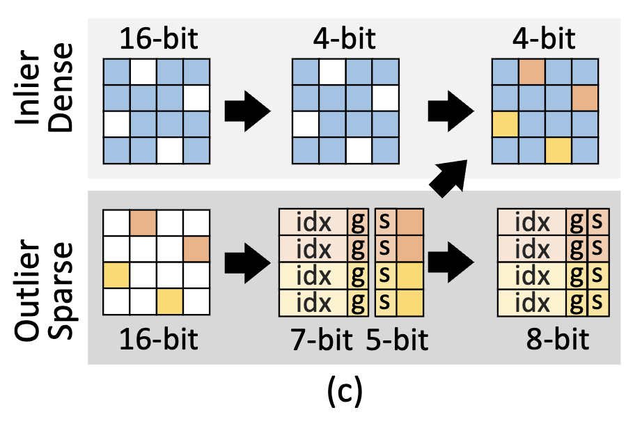

- middle：4-bit，存在 dense matrix
- inner、outer：存成（位置, 值）的 pair（COO），dense 裡對應的位置清成 0
- 把 dense 裡清成 0 的空位拿來存一部分的值，每個 pair 從 23 bit 降到 8 bit

<!--
最後是 fused dense-and-sparse encoding，分 dense 和 sparse 兩邊來看。
dense 這邊，大部分的值，也就是 middle，放在 dense matrix，每個值 4-bit。
sparse 這邊，少數的 inner 和 outer 只存位置和值組成的 pair，這種格式叫 COO。每個 pair 除了值，還要額外存位置，用 FP16 的話一個 pair 要 23 bit。Oaken 先用 group-shift 把值壓到 5-bit，再利用 dense 的空位：inner 和 outer 在 dense 裡對應的位置本來清成 0，空著的 4 bit 剛好拿來存值的 4 bit，剩下的放在 sparse，一個 pair 只要 8 bit。
固定 8 bit 也剛好對齊，後面的 MMU 才好用 page 管理。
-->

---

<!-- _class: fig -->

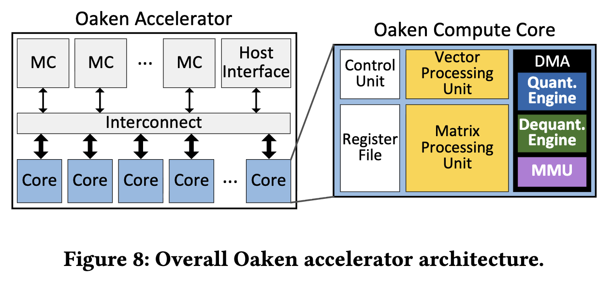

<!--
這頁是整個硬體架構圖，memory controller 負責跟這個加速器的 off-chip memory 讀寫。host interface 用 PCIe 跟 host 溝通，也負責把進來的 request 排程、分給各個 core。interconnect 把這些接在一起。
Oaken 的 compute core 源自 HyperAccel 以前發表過的 LPU。每個 core 攤開來，MPU 負責 matrix-vector 乘法，把從 memory 讀進來的 weight 串流處理，VPU 負責 matrix-vector 之間的 element-wise 運算。DMA unit 負責在 memory 和處理單元之間搬資料，以及 quant / dequant / MMU，用來實現前面講的 KV 量化。
-->

---

<!-- _class: fig -->

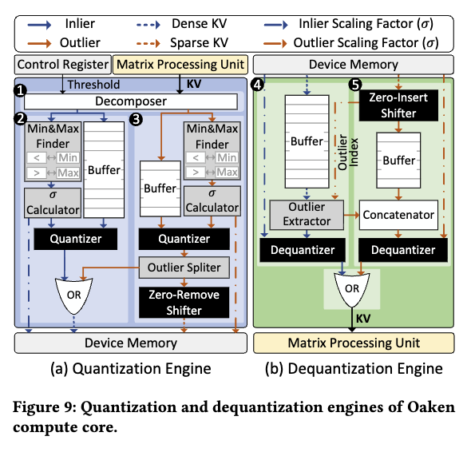

<!--
這頁是 DMA unit 裡的 quantization 和 dequantization engine，左邊 quantization 這邊，decomposer 先把進來的值分成三組，outer、middle、inner，其中 outer 跟 middle 會減掉 threshold 做 group-shift。

middle 走 ② 這條路線，找 min / max、算 scale，量化成 4-bit。

outer 跟 inner 則是走 ③ 這條路線，各自找 min 和 max、算 scale，量化成 5-bit。

最後兩條路徑用 OR gate 合併，寫成 dense matrix。

右邊的路線會額外產生 index 和 group，組成 sparse。

dequantization 這邊是反過來。④ 和 ⑤ 兩個 dequantizer 分別處理 dense 和 sparse，sparse 那邊用 zero-insert 把位置還原，最後兩邊再用 OR gate 合併，送給 processing unit。
-->

---

<!-- _class: fig -->

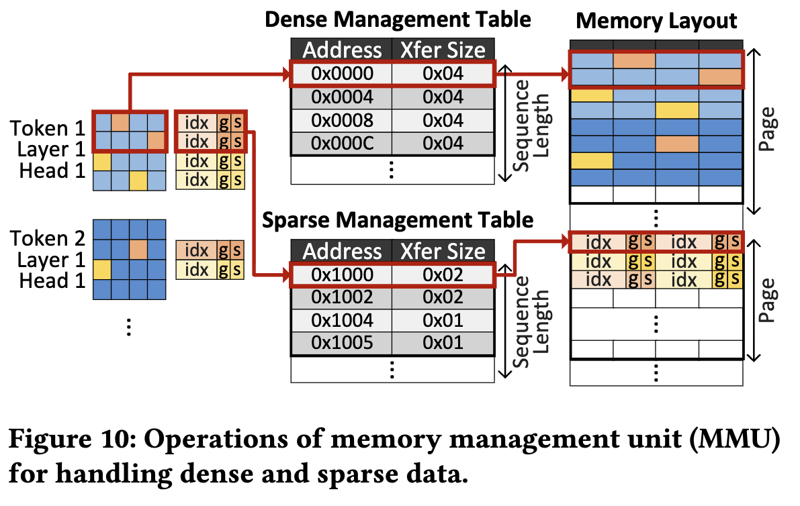

<!--
這頁是 MMU，負責管理量化後 KV cache 的讀寫，因為有 multi-request，不能直接按照 max sequence length 去索取記憶體，而是動態的像是 OS 管理記憶體那樣，用 page 為單位來管理。要處理兩個問題。
第一，dense 的大小固定、也對齊，但 sparse 的大小每次都不一樣，所以 dense 和 sparse 各有一張 management table，記錄虛擬位址對應到實體位址，以及要傳多少資料。實體位址是 inference 的時候，依照目前還有哪些 page 可以用，動態算出來的。
第二，要盡量用 burst access 讀 memory。因為寫入只會有一次，剩下都是讀，所以 Oaken 把當前 token 的 KV 依照 attention head 分開，寫到不同的 page，下一個 token 的 KV 就接在前一個 token 後面依序寫。這樣讀所有過去 token 的 KV 時，就可以用 burst 一次讀很多，有效利用 bandwidth。
-->

---

## Config

| | A100 | Oaken-HBM | Oaken-LPDDR |
|---|---|---|---|
| Peak FP16 TFLOPS | 312 | 270 | 270 |
| Frequency | 1.4 GHz | 1.0 GHz | 1.0 GHz |
| Memory | HBM 80 GB | HBM 80 GB | LPDDR 256 GB |
| Bandwidth | 2.0 TB/s | 2.0 TB/s | 1.1 TB/s |

- 模型：Llama2（7B、13B、70B）、OPT（6.7B、13B、30B）、Mistral-7B、Mixtral-8x7B
- Baseline：vLLM（FP16，不量化）
- 量化（4-bit、只量化 KV cache）：QServe、KIVI、KVQuant（A100），Tender（對齊 A100）

<!--
這頁是 config。模型用了八個，Llama2、OPT、Mistral、Mixtral，大小從 6.7B 到 70B。
硬體用 SystemVerilog 寫 RTL，在 TSMC 28nm、1 GHz 合成，用來量面積和功耗。
比較的對象，GPU 這邊是 A100，用 vLLM 跑 FP16 當 baseline，除了 Tender 以外的量化算法都在 A100 上跑，塞不下的話就用兩張。Tender 是 accelerator，他們把 Tender 的記憶體和算力設定對齊 A100。這些量化的 baseline 都是 4-bit、只量化 KV cache。
表是硬體規格。Oaken-HBM 的記憶體跟 A100 一樣，HBM 80 GB、2.0 TB/s；Oaken-LPDDR 是 LPDDR 256 GB、1.1 TB/s。表上 Oaken 的 FP16 算力是 270 TFLOPS，A100 是 312。
-->

---

<!-- _class: fig -->

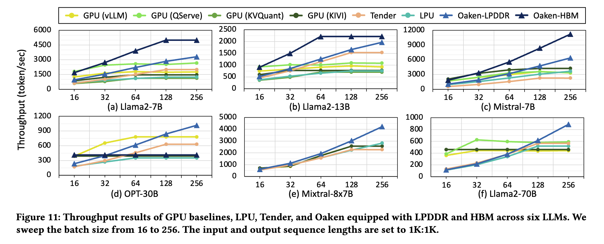

<!--
這頁是 throughput，Fig 11，六個模型，batch size 從 16 掃到 256，input 和 output 都是 1K。Oaken 的數字是 simulator 的結果。
batch 256 的時候，Oaken-LPDDR 平均比 vLLM 高 1.79 倍，比 QServe 高 1.58 倍。原因是 attention 佔了大部分的 inference 時間，Oaken 減少了對 KV cache 的 memory access，所以 attention 變快。
GPU 的 baseline 在 batch 小、模型小的時候表現不錯，但 batch 變大就放不下，throughput 就飽和了。Tender 用的記憶體跟 A100 一樣是 HBM，所以也一樣沒辦法 scale。
Oaken-HBM 在模型小、batch 小的時候最快，但遇到大模型或是大 batch，capacity 不夠。這時候 Oaken-LPDDR 因為 capacity 大，可以持續 scale。
-->

---

<!-- _class: fig -->

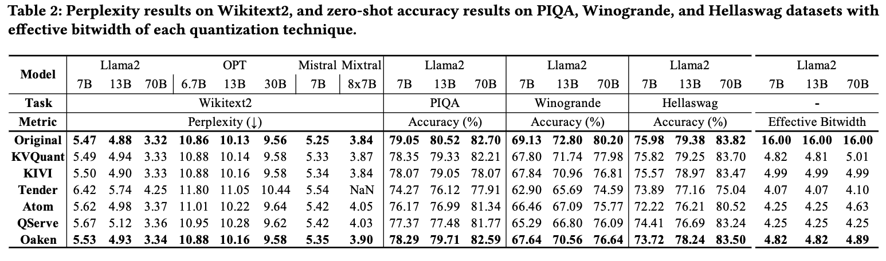

<!--
Oaken 平均比 FP16 掉 0.87%，比 KVQuant 和 KIVI 稍差，分別是 0.54% 和 0.32%，但它們的 effective bitwidth 較大、overhead 也大。
比 QServe 好 1.38%。
-->

---

<!-- _class: fig -->

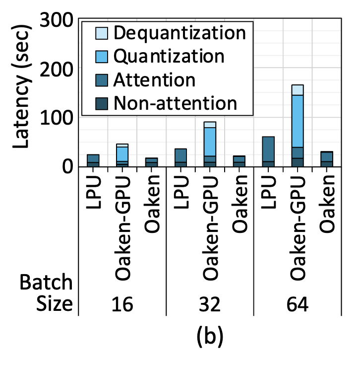

<!--
這頁是 latency breakdown，Llama2-7B，batch size 16、32、64，比較 LPU、Oaken 的演算法放在 GPU 上跑，還有 Oaken-LPDDR。
attention 的時間隨 batch 成比例增加。Oaken 不影響 non-attention 的時間，但是 KV 量化減輕了 bandwidth 的壓力，所以 attention 的時間平均比 LPU 少 55%。batch 64 的時候，quantization 和 dequantization 只佔整體 latency 的 1.29% 和 3.23%。
相反的，Oaken 的演算法放到 GPU 上跑，quantization 和 dequantization 很慢，因為要分開多個 group，CUDA 會有 warp divergence。
-->

---

## 面積與功耗（TSMC 28nm）

| Module | Area (mm²) | Area ratio (%) |
|---|---|---|
| Matrix processing unit | 0.908 | 22.86 |
| Vector processing unit | 0.239 | 6.03 |
| Quantization engine | 0.074 | 1.86 |
| Dequantization engine | 0.252 | 6.35 |
| Compute core | 3.971 | 100 |

- Quantization + dequantization engine：8.21% 的 compute core 面積
- 整個 accelerator：222.7 W，比 A100 的 400 W TDP 低 44.3%
- 論文沒說：剩下約 63% 的面積是什麼、8.21% 有沒有包含 MMU、222.7 W 的算法與 TDP 的比較基準。

<!--
這頁是面積和功耗，用 TSMC 28nm 合成。quantization engine 佔 compute core 的 1.86%，dequantization engine 佔 6.35%，合起來 8.21%，論文說這是很小的 overhead。整個 accelerator 的功耗是 222.7 W，論文拿來跟 A100 的 400 W TDP 比，低 44.3%。
不過有幾個地方論文沒有講清楚。表上 MPU、VPU 和兩個 engine 加起來只有約 37%，剩下約 63% 的面積是什麼沒有說。8.21% 有沒有包含 MMU 也沒說。222.7 W 是怎麼算的也沒說，而 A100 的 400 W 是 TDP，不是實測功耗，兩邊的比較基準可能不一樣。
-->

---

## 總結

- 問題：大 batch 下，KV cache 同時吃 bandwidth 和 capacity
- 方法：online-offline hybrid 的 KV 量化（offline threshold、group-shift、fused dense-and-sparse），加上 quantization / dequantization engine 與 MMU
- 結果：batch 256，Oaken-LPDDR 的 throughput 平均比 vLLM 高 1.79 倍、比 QServe 高 1.58 倍，accuracy 掉 0.87%，兩個 engine 佔 compute core 面積 8.21%

<!--
總結一下。這篇處理的是大 batch 下，KV cache 同時吃 bandwidth 和 capacity 的問題。做法是 KV cache 量化，演算法這邊用 online-offline hybrid，offline 先決定 threshold，再用 group-shift 和 fused dense-and-sparse 把 bitwidth 壓下來；硬體這邊在 DMA unit 加了 quantization、dequantization engine 和 MMU。
結果是 batch 256 的時候，Oaken-LPDDR 的 throughput 平均比 vLLM 高 1.79 倍，比 QServe 高 1.58 倍，accuracy 只掉 0.87%，兩個 engine 佔 compute core 面積 8.21%。
-->

---

<!-- _class: cover -->
<!-- _paginate: false -->

# Thanks

<!--
謝謝大家，以上是我的報告。
-->