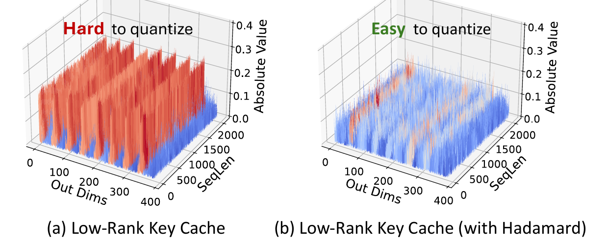
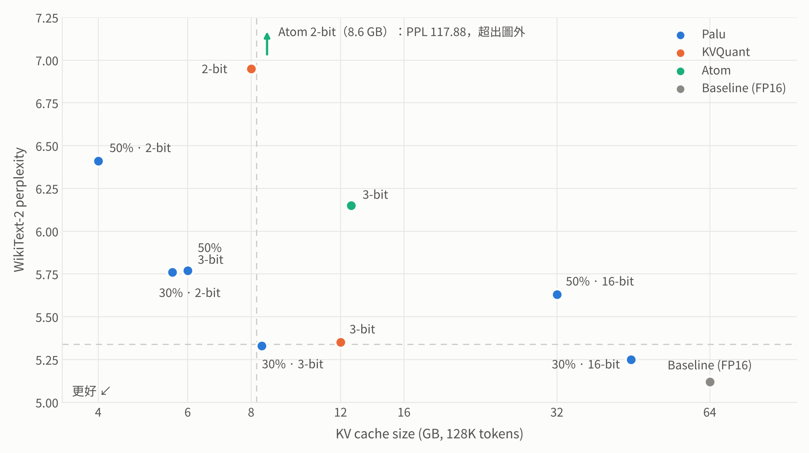

<!-- _class: cover -->
<!-- _paginate: false -->

# Palu: KV-Cache Compression with Low-Rank Projection

`NYCU` `UW` `Cornell` `ICLR 2025` `arXiv 2407.21118`

Chi-Chih Chang, Wei-Cheng Lin, Chien-Yu Lin, Chong-Yan Chen, Yu-Fang Hu, Pei-Shuo Wang, Ning-Chi Huang, Luis Ceze, Mohamed S. Abdelfattah, Kai-Chiang Wu

報告人：莊翔鈞

<!--
今天報告的這篇，是陽明交大、華盛頓和康乃爾大學合作的，發表在 ICLR 2025。這篇是交大資工吳凱強教授帶領的團隊，前三位作者 張機智、Wei-Cheng Lin、Chien-Yu Lin 是 equal contribution。 它處理的是 LLM decode 時 KV cache 太大的問題。過去的壓縮方法是quantization或eviction，Palu 則是壓縮 KV 的 hidden dimension：用low rank decomposition把 key 和 value 的投影權重拆開，cache 只存比較短的 latent，要用的時候再還原。而且這篇是純演算法加 GPU kernel，沒有做硬體。
-->

---

## 動機

| 壓縮方向 | 縮小什麼 | 代表方法 |
|---|---|---|
| Quantization | 每個元素的 bitwidth | KIVI、KVQuant |
| Token eviction | token 的數量 | H2O、StreamingLLM |
| **Palu（low-rank）** | hidden dimension 的維度數 | - |

<!--
這篇提出的方法是 post-training，在hidden dimension 層面做壓縮。他跟quantization以及eviction 是正交的所以可以疊加使用
-->

---

## Low rank

$$
\underbrace{\begin{bmatrix}1&0&1\\0&1&1\\1&1&2\end{bmatrix}}_{W\ (3\times3)}
=
\underbrace{\begin{bmatrix}1&0\\0&1\\1&1\end{bmatrix}}_{A\ (3\times2)}
\underbrace{\begin{bmatrix}1&0&1\\0&1&1\end{bmatrix}}_{B\ (2\times3)}
$$

- row 1、row 2 是兩個獨立方向，row 3 = row 1 + row 2：rank = 2
- 每個 row 只需要 2 個係數（A 的那一列），乘上 B 的兩個方向，就能還原出 3 個數字
- rank 為 $r$：每個 row 只要 $r$ 個係數，不用 $n$ 個

<!--
先介紹兩個核心概念，low rank 跟 SVD。Rank 就是矩陣裡獨立方向的數量。投影片裡的例子，前兩個 row 是獨立的，第三個 row 是它們的和，所以只有兩個獨立方向，rank 是 2。這樣我們就可以用 A，也就是還原的係數，跟 B 這些獨立的向量，組合出原本的矩陣，這叫 low rank factorization。如果故意省掉一部分 rank，雖然沒辦法 lossless 還原，但像量化那樣，大致還原已經夠用了。問題是要留哪些方向，下一頁用 SVD 來回答。
-->

---

## SVD

$$
W = U\,\Sigma\,V^\top,\qquad \Sigma = \mathrm{diag}(16,\ 8,\ 4,\ 2)
$$

$$
\begin{bmatrix}7.5&2.5&4.5&1.5\\2.5&7.5&1.5&4.5\\4.5&1.5&7.5&2.5\\1.5&4.5&2.5&7.5\end{bmatrix}
\ \approx\
\begin{bmatrix}7&3&5&1\\3&7&1&5\\5&1&7&3\\1&5&3&7\end{bmatrix}
$$

- $\Sigma$ 對角線是 singular value，由大到小排序
- 丟掉最小的 $2$：rank 4 → 3，每個元素最多只差 $0.5$

<!--
SVD 把矩陣拆成 U、Σ、V，其中 Σ 對角線上的 singular value 由大到小排序，越大的方向越重要。
這個 4×4 的例子，singular value 是 16、8、4、2。如果丟掉最小的 2，rank 從 4 變成 3，還原出來的矩陣每個元素最多只差 0.5，原本的值最大是 7.5，所以差不多。
Palu 就是對權重做這件事，只保留前 r 個最大的方向。
-->

---

## 核心想法

```text
Original:  x ──W──▶ k               cache k  (d numbers)
Palu:      x ──A──▶ h ──B──▶ k      cache h  (r numbers)
```

- $x$：當前 token，$W$：key 的投影權重，$d$：hidden dimension
- 離線對 $W$ 做 SVD，保留前 $r$ 個方向：$W \approx AB$，$r < d$
- cache 存 latent $h = xA$，要用 $k$ 的時候再算 $hB$；value 同理

<!--
Palu的做法就是善用前面提到的low rank和svd，原本 key 是 token x 乘上投影權重 W 得到 k，然後把 k 存進 cache，長度是 d。Palu會先離線對W做SVD，只保留前 r 個最大的方向，把 W 近似成 A 乘 B。A 把 token 投影成 r 個係數，也就是 latent h；B 就是那 r 個方向，用來還原 k。 所以 cache 存的是長度 r 的 h，不是長度 d 的 k。要做 attention 的時候，再用 B 把 k 還原出來。Value 也是同樣的做法，各有自己的 A 和 B。 svd 只需要離線做一次，因為 W 是固定的權重。 代價是每次要用 k 的時候多了還原這一步，後面會講怎麼fuse。
-->

---

## Matrix fusion（Value 端）

$$
p\,V\,W^o = p\,(H B)\,W^o = p\,H\,(\underbrace{B\,W^o}_{\text{離線先乘好}})
$$

- $p$：attention weight，$V$：value，$H$：cache 裡的 latent，$W^o$：output projection
- $B$ 和 $W^o$ 都是固定的權重，可以離線先乘好
- 執行時不用還原 value，直接用 latent $H$ 算

<!--
還原會多一些計算，不過 value 這一邊可以完全避開。Attention 的輸出是 pV再乘上 output projection 也就是Wᵒ。V 本來是 H 乘 B，所以整個式子是 p 乘 H 乘 B 乘 Wᵒ。 B 和 Wᵒ 都是固定的權重，矩陣乘法有結合律，所以可以離線先把 B 和 Wᵒ 乘好。這樣執行時就不用還原 V，直接用 latent H 去算。論文也提到這樣還會減少 output projection 的運算量。
-->

---

## Matrix fusion（Key 端）

| | Attention score | 還原 $K$？ |
|---|---|---|
| 沒有 RoPE | $qK^\top = x\,(W^q B^\top)\,H^\top$ | 不用，$W^q B^\top$ 離線先乘好 |
| 有 RoPE（如 Llama） | $\mathrm{RoPE}(q)\,\mathrm{RoPE}(HB)^\top$ | 要，先還原 $K = HB$ 才能旋轉 |

- $q = xW^q$：當前 token 的 query，$K = HB$
- 有 RoPE：自訂 Triton kernel，把還原 $K$、RoPE、乘 $q$ 融成一個

<!--
Key 這邊比較麻煩，要分有沒有 RoPE。Attention score 是 q 乘上 K transpose，K 是 H 乘 B。沒有 RoPE 的時候，展開之後是 x 乘 Wq 乘 Bᵀ 乘 Hᵀ，Wq 和 Bᵀ 都是固定的權重，可以離線先乘好，所以不用還原 K。 有 RoPE 的時候，像 Llama，q 和 K 在相乘之前都要先做 RoPE，也就是依照位置旋轉。因為旋轉要先把K還原出來，Wq 和 Bᵀ 沒辦法fuse。作者的workaround 是寫了一個 GPU kernel，把還原 K、做 RoPE、跟 q 相乘融在同一個 kernel 裡，盡量在on-chip完成，減少資料搬運。 ALiBi、MLA 這類不直接對 key 做位置編碼的架構，就屬於沒有 RoPE 的情況，可以直接 fuse。
-->

---

## 分解粒度

| | 一起分解的 head | 準度 | 還原成本（相對 M-LRD） |
|---|---|---|---|
| M-LRD | 1 個（各自分解） | 最低 | 1× |
| G-LRD | $s$ 個（一組） | 中 | $s$× |
| J-LRD | 全部 | 最高 | head 數 × |

- 一起分解的 head 越多，越能保留 head 之間共通的資訊，準度越好
- 但還原要用的 latent 也越多，成本越高（latent 總量固定時）

<!--
前面為了簡化，是用單一 head 來講。剛剛提到的做法都只發生在一個head裡面，每個head自己做分解，這個叫做M-LRD，M是multi的意思。作者推測head之間其實有一些資訊是共享的，所以嘗試了所有head的權重concatenate在一起，一塊做SVD，拼接的數量越多，準度越好，但代價是還原的成本越高，全部拼在一起時是head數量的倍數。這樣所有拼在一起的做法叫J-LRD, J是joint的意思。還有一個折衷的方法，每s個head作為一個group，一塊做分解，叫做G-LRD，G是group的意思，在準度跟還原成本做個平衡。
-->

---

## Rank 分配

| PPL（Llama-2-7B） | 30% | 50% | 70% |
|---|---|---|---|
| 每個矩陣 rank 一樣 | 6.34 | 7.36 | 10.77 |
| Fisher 分配 | 5.62 | 6.02 | 8.59 |

- 每層的 key、value 對壓縮的敏感度不同，每個矩陣留一樣多的 rank 不是最好
- 用 Fisher information 估計每個矩陣的重要性，rank 的比例 = 它的 Fisher information ÷ 全部加總

<!--
另一個設計是每個矩陣要留多少 rank。每一層的 key 和 value 對壓縮的敏感度不一樣，所以不適合每個都留一樣多。作者用 Fisher information 來估計每個權重矩陣的重要性：給定權重矩陣和好幾個樣本資料，對矩陣裡每個參數的 gradient 做平方，再對樣本取平均，得到每個參數的重要性；把矩陣裡所有參數的重要性加總，就是這個矩陣的分數。每個矩陣都算完之後，按照分數佔全部的比例來分配 rank 的預算，越重要的保留越多 rank，整體的壓縮率不變。
-->

---

<!-- _class: fig -->

## 量化相容



Llama-2 第 4 層 key 的 latent 分布：(a) 每一組的開頭有特別大的值，不好量化；(b) 乘上 Hadamard 之後分布變平

<!--
最後是跟量化的結合。Palu 跟 quantization 是正交的，可以疊加，但作者發現 latent 不好量化：SVD 會把大的 singular value 排在前面，所以 latent 每一組的開頭會有特別大的值，也就是 outlier，那這對量化不友善。
-->

---

## Hadamard

$$
W \approx AB = (AR)(R^\top B)
$$

- $R$：Hadamard matrix（正交矩陣），把大值攤平，量化更準
- $AR$、$R^\top B$ 都是權重，離線先算好，執行時沒有額外運算

<!--
解法是用 Hadamard transform，把 latent 乘上一個 Hadamard 矩陣 R，這是一個正交矩陣，會把大的值攤到各個位置，分布變平，量化會比較好。 一般的做法要在執行時多做一次轉換。但是 Palu 的 A 和 B 本來就是一對，R 乘 Rᵀ 等於單位矩陣，所以可以把 R 放在 A 的後面、Rᵀ 放在 B 的前面，AR 和 RᵀB都可以先離線算好，decode的時候沒有額外的成本。
-->

---

## 分解粒度的準度

50% 壓縮率；Palu 預設是 G-LRD（一組 4 個 head）

| 模型 | 方法 | Wiki2 PPL ↓ | C4 PPL ↓ | Zero-shot Avg. (%) ↑ |
|---|---|---|---|---|
| Llama-2-7B | Baseline | **5.47** | 7.26 | **65.05** |
| | J-LRD | 5.62 | 7.75 | **64.82** |
| | G-LRD | 6.01 | 9.82 | **62.61** |
| | M-LRD | **6.75** | 12.01 | **57.79** |
| Llama-3-8B-Inst | Baseline | 8.28 | 13.01 | 67.99 |
| | J-LRD | 9.12 | 15.90 | 66.19 |
| | G-LRD | 10.11 | 17.87 | 64.45 |
| | M-LRD | 12.38 | 23.02 | 58.40 |

<!--
先看分解粒度的結果，50% 壓縮率，Llama-2-7B 跟 Llama-3-8B-Instruct。Palu 預設用一組 4 個 head 的 G-LRD。
結果跟前面講的一致：一起分解的 head 越多，準度越好。J-LRD 幾乎沒掉，zero-shot 平均只少 0.23；M-LRD 掉最多，掉了 7 分多，PPL 也從 5.47 變到 6.75；G-LRD 在中間，掉 2 分多。
Llama-3 趨勢一樣，只是掉得更多。
所以越準的做法，重建越貴，G-LRD 是在兩者之間取捨後的預設。
-->

---

<!-- _class: fig -->

## 疊加量化



Llama-2-7B；PPL 在序列長度 4096 測，KV cache 換算成 128K 序列；Palu = G-LRD（4 heads）＋ per-token 量化；左下角越好。資料：Palu Table 2

<!--
這張圖橫軸是 KV cache 大小，縱軸是 PPL，越靠左下越好，baseline 在右下角。只做低秩的點還在右邊，單靠低秩壓不到很小，要再疊上量化。
先看這條橫線，固定準度：KVQuant 3-bit 跟 Palu-30% 加 3-bit 的 PPL 幾乎一樣，但 Palu 的 KV cache 少了大約三成。
再看這條直線，固定記憶體：大概 8 GB，KVQuant 2-bit 的 PPL 已經明顯變差，Palu-30% 加 3-bit 在差不多的大小下，PPL 還接近 baseline。Atom 在 2-bit 直接崩掉，超出圖外。
低秩壓一次、量化再壓一次，比例相乘，所以可以壓到更小。代價是越壓 PPL 越高，最左邊那個 4 GB 的點已經到 6.4。
-->

---

## 長文本準度

Mistral-7B-v0.2，LongBench；Bits 與壓縮率以 10K context 估算；Synthetic 為合成任務（長文本檢索類）

| 方法 | Bits | 壓縮率 | Synthetic | Avg. |
|---|---|---|---|---|
| Baseline | 16 | 1.00x | **44.87** | 42.54 |
| Palu-30% | 16 | 1.43x | 37.92 | 41.55 |
| Palu-50% | 16 | 2.00x | **16.88** | 36.23 |
| KIVI-2 | 3.16 | **5.05x** | 40.28 | 41.45 |
| Palu-30% | 3 | **7.59x** | 34.74 | 40.77 |
| Palu-50% | 3 | 10.6x | 18.57 | 35.71 |

<!--
這頁看長文本，LongBench，模型是 Mistral-7B。
Palu-30% 的平均分數幾乎沒掉，再疊上 3-bit，合起來也只掉不到 2 分，壓縮率到 7.6 倍。跟 KIVI 比，準度差不多，但壓縮率多了一截，KIVI 大約 5 倍。
但是壓到 50% 就撐不住了，掉最多的是 Synthetic，從 44.87 掉到 16.88，平均也被拖下來。
-->

---

## Latency

| 方法 | 有 RoPE | 無 RoPE |
|---|---|---|
| Palu（低秩） | **1.89x** | **2.20x** |
| Palu + 4-bit 量化 | **2.91x**（只量化 Value） | **6.17x**（Key、Value） |
| KIVI-4-bit | **1.89x** | - |

- Llama-2-7B，RTX 4090，單 GPU
- KV cache 壓 50%（Key 75%、Value 25%）
- 表中為 attention module 在 64K 序列的結果

<!--
最後看 latency。Llama-2-7B 跑在一張 RTX 4090，KV cache 壓 50%（Key 75%、Value 25%），不用 FlashAttention，另外 4090 記憶體小，所以 linear layer 的權重用 4-bit。
序列短幾乎沒加速，越長越明顯。
有 RoPE：Key 用 kernel 在線重建、Value 用 fusion，low rank 是 1.89 倍；加 4-bit 到 2.91 倍，但只能量化 Value，因為 Key 的 kernel 目前只支援 FP16。KIVI-4-bit 只有 1.89 倍，所以 Palu 加量化比 KIVI 快。
沒有 RoPE：Key、Value 都能 fusion，重建成本完全消掉，low rank 是 2.20 倍，加 4-bit 到 6.17 倍。
-->

---

## 總結

- 離線把 $W_k$、$W_v$ 低秩分解，只存 latent，post-training、不用重訓
- G-LRD 在準度與重建成本之間折衷；Fisher 分配 rank
- 與量化正交：Hadamard 處理 latent 的 outliers，疊加後 KV cache 壓到 **5.6 GB**（Palu-30%、2-bit，PPL **5.76**）
- Fusion 與 GPU kernel 讓壓縮變成 latency 加速：64K 時 attention module 最高 **6.17x**

<!--
總結一下。Palu 是 post-training 的 KV cache 壓縮：離線把 W_k 和 W_v 做低秩分解，cache 只存 latent，不用重訓。
分解粒度選 G-LRD，在準度和重建成本之間折衷，rank 用 Fisher information 分配。
它跟量化互相獨立，用 Hadamard 把 latent 的 outliers 攤開，疊加之後 Llama-2-7B 在 128K 的 KV cache 從 64 GB 壓到 5.6 GB，PPL 是 5.76，baseline 是 5.12。
Matrix fusion 加上 GPU kernel，讓壓縮真的變成 latency 加速，64K 的 attention module 最高 6.17 倍。
-->

---

## 限制

- 50% 壓縮在長文本任務損失明顯（LongBench Synthetic：44.87 → 16.88）
- RoPE 的 Key 要在線重建，kernel 只支援 FP16；序列超過 16K 後重建變 compute-bound，kernel 加速下降
- 只評估 decode latency；論文沒有說明 batch size

<!--
最後講限制。第一，壓 50% 的時候長文本準度掉得明顯，尤其 Synthetic 從 44.87 掉到 16.88。
第二，有 RoPE 的 Key 要在線重建，這個 kernel 目前只支援 FP16，而且序列超過 16K 之後重建變成 compute-bound，kernel 的加速會下降。如果這有 ASIC 的話，或許是很好的解決方案。
第三，論文只評估 decode 的 latency，也沒有說明 batch size，所以 batch 很大的情況下效果怎麼樣，論文沒有回答。
-->

---

<!-- _class: cover -->
<!-- _paginate: false -->

# Thanks!

<!--
雋奕說他在 VLSI CAD 的某個 poster session 有遇到，他們把四篇 paper 結合在一起做成國科會計畫，其中一篇叫 xKV，也是 low rank 的做法，我下次應該會報那篇。
-->